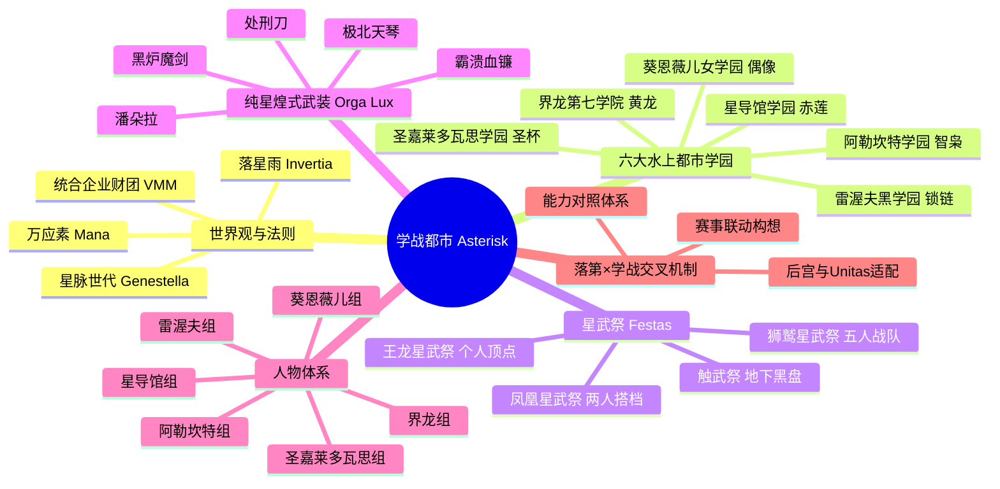

# 《学战都市Asterisk》研究总览与知识中枢

> **知识库说明**：本知识库基于 `DLC/插图` 16 卷官方原版插图 OCR 扫描成果，结合三屋咲悠原作轻小说设定体系梳理而成。
> 本仓库为独立的 **Obsidian 知识图谱研究仓库**，完整收录水上学园都市六花的世界观、六大学园体系、星武祭规则、纯星煌式武装规格及核心角色档案。

---

## 🗺️ 知识库核心导航

---

## 📂 分类索引入口

1. **[[01_世界观与核心规则/落星雨(Invertia)与万应素(Mana)|落星雨与万应素]]**：世界崩溃与重构之源。
2. **[[01_世界观与核心规则/星脉世代(Genestella)与魔女·魔术师|星脉世代与魔女/魔术师]]**：新人类与超常能力的本质机制。
3. **[[01_世界观与核心规则/星武祭(Festas)三大赛事与触武祭|星武祭与触武祭运作体系]]**：六花学园学生争霸的竞技擂台。
4. **[[01_世界观与核心规则/统合企业财团(VMM)六大财团|六大统合企业财团]]**：掌控世界的幕后巨头。
5. **[[02_六大水上学园/六大学园综合比对|六大水上都市学园全貌]]**：星导馆、圣嘉莱多瓦思、界龙、阿勒坎特、葵恩薇儿、雷渥夫。
6. **[[03_纯星煌式武装与魔导兵器库/纯星煌式武装机制与万应矿|纯星煌式武装库]]**：黑炉魔剑、潘朵拉、霸溃血镰等规格收录。
7. **[[04_登场人物档案库/全人物检索索引|登场人物档案总表]]**：天雾绫斗、尤莉丝、沙沙宫纱夜、克劳蒂雅、刀藤绮凛、席尔薇雅、范星露等全员图鉴。
8. **[[05_插图OCR全量台账/插图OCR识别总台账|插图OCR识别总台账]]**：全 16 卷 150 张彩插/封面封底文本完整提取收录。
9. **[[06_落第×学战交叉研究/伐刀者与星脉世代能力对照表|落第×学战交叉研究]]**：两界战力换算与联动世界书机制。
10. **[[第一卷-世界书整理/00_第一卷_正文精读与评注导航|第一卷·正文精读与评注工作台]]**：第一卷全章节正文 Markdown 原文精读、全彩及黑白插图原位内嵌、即点即写分幕批注与世界书整理清单。
