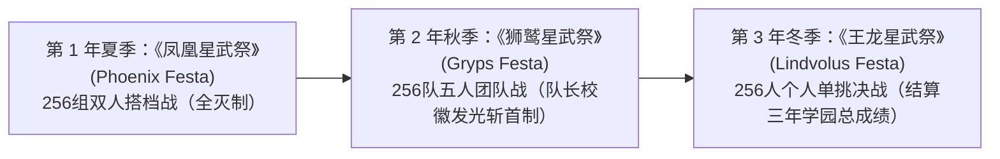

# 星武祭 (Festas) 三大赛事与蚀武祭

> 标签：#竞技赛事 #星武祭 #凤凰星武祭 #狮鹫星武祭 #王龙星武祭 #蚀武祭

## 1. 星武祭 (Festas) 概述
由统治六花的六大统合企业财团联合运营的全球最大规模学生综合武斗赛事。三年为一周期，轮流举办三场不同规则的大会（完整世界书规则词条详见下方链接）：

### (1) [[../第二卷-世界书整理/词条与设定条目/凤凰星武祭_双人搭档战规则与赛制|《凤凰星武祭》(Phoenix Festa)]]
* **赛制**：第 1 年夏季，256 组（512 人）同校双人搭档淘汰赛。
* **核心特征**：必须破坏敌方搭档**两人全部**的校徽（或令两人均失去意识/弃权）方能获胜；即便一人先出局，另一人仍可一打二翻盘。冠军搭档两人各自可许一个愿望。

### (2) [[../第二卷-世界书整理/词条与设定条目/狮鹫星武祭_五人团队战规则与赛制|《狮鹫星武祭》(Gryps Festa)]]
* **赛制**：第 2 年秋季，256 队（1,280 人）五人小队团体淘汰赛（最多容许两人缺席、最少三人登台；允许招募一生限参赛一次的「佣兵生」）。
* **核心特征**：每场指定一名**「队长（Leader）」**（校徽散发微光，可按场次轮换人选，与注册「队伍代表者」分离），**击碎敌方队长校徽即刻宣告全队胜利**。冠军队五人各自享有独立许愿权。

### (3) [[../第二卷-世界书整理/词条与设定条目/王龙星武祭_个人锦标赛规则与赛制|《王龙星武祭》(Lindvolus Festa)]]
* **赛制**：第 3 年冬季，256 人个人单挑淘汰赛（台版第一卷图解曾印作 `Lindbulps`）。
* **核心特征**：源自七十三年前首届个人战，号称“《星武祭》中的《星武祭》”；赛后结算三年赛季学园综合成绩，第一名学园的学生会长出任下一季《六花园会议》议长。

## 2. 规则与胜负判定：校徽认证与《星武宪章》
* 参赛资格限定 **13 岁至 22 岁**，每名学生生涯合计最多参加 **3 次**《星武祭》。
* 全市动用 **11 座舞台**（天狼星巨蛋主舞台 + 3 座大规模 + 7 座中规模）：前 7 日进行三轮预赛筛出 32 强，第 8 日休整并重新抽签进入本战。
* 破坏对手校徽、令对手失去意识（校徽芯片自动监测）或迫使对手弃权即获胜；严禁蓄意虐杀。

## 3. 暗之地下竞技：《蚀武祭》
* **性质**：由雷渥夫黑学院学生会长《恶辣之王》狄路克·艾贝尔范等势力在再开发区废弃设施暗中操盘的非法地下赌博竞技（详见第十二卷）。
* **规则**：无视《星武宪章》与校徽保护机制的危险黑市乱斗。

---
关联词条：[[02_六大水上学园/六大学园综合比对|六大学园]] | [[04_登场人物档案库/全人物检索索引|参赛人物库]]
