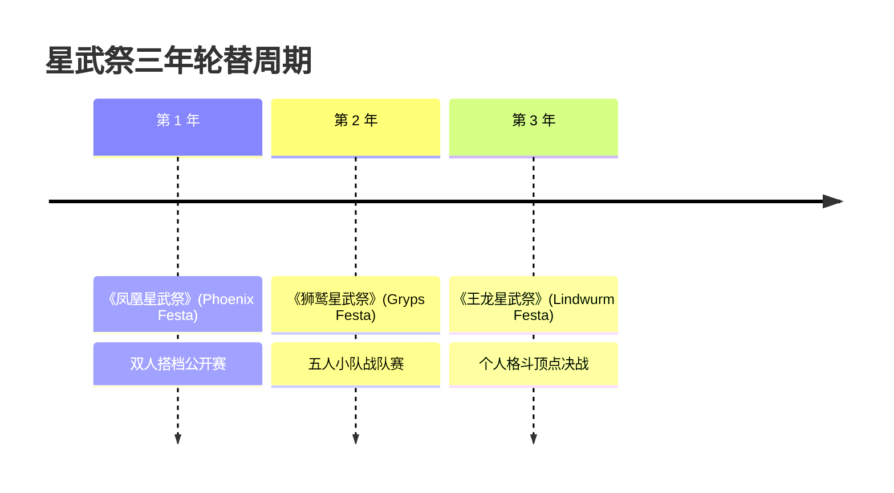

# 星武祭 (Festas) 三大赛事与触武祭

> 标签：#竞技赛事 #星武祭 #凤凰星武祭 #狮鹫星武祭 #王龙星武祭 #触武祭

## 1. 星武祭 (Festas) 概述
由统治六花的六大统合企业财团联合运营的全球最大规模学生综合武斗赛事。三年为一周期，轮流举办三场不同规则的大会：

### (1) 《凤凰星武祭》(Phoenix Festa)
* **赛制**：2人组队双打制。
* **核心特征**：重视二人搭档的默契配合、属性互补与攻防分工。
* **经典组合**：天雾绫斗 & 尤莉丝·爱雷克西亚；沙沙宫纱夜 & 刀藤绮凛；阿尔达克自主型拟形体组。

### (2) 《狮鹫星武祭》(Gryps Festa)
* **赛制**：5人一队团队战。
* **核心特征**：设有一名“队长（King）”，击碎敌方队长校徽即宣告胜利；极度考验团队战术纵深与大局指挥。

### (3) 《王龙星武祭》(Lindwurm Festa)
* **赛制**：个人无差别淘汰赛。
* **核心特征**：Asterisk 个人武力最强者的至高角逐，各校序列第一与怪物体质全员单挑。

## 2. 规则与胜负判定：校徽认证 (School Crest)
* 参赛者胸前均佩戴学园校徽（内置万应素感知芯片）。
* **破坏校徽即被判定出局**，无论身体是否仍能战斗。此规则有效保障了竞技不会过度升级为不可逆的致命虐杀。

## 3. 暗之地下竞技：触武祭 (Dian Cecht)
* **性质**：由雷渥夫黑学园恶辣之王狄路克等势力暗中操盘的地下黑市格斗盘。
* **规则**：无限制、无校徽保护机制，以生死与血腥作为赌注。

---
关联词条：[[02_六大水上学园/六大学园综合比对|六大学园]] | [[04_登场人物档案库/全人物检索索引|参赛人物库]]
