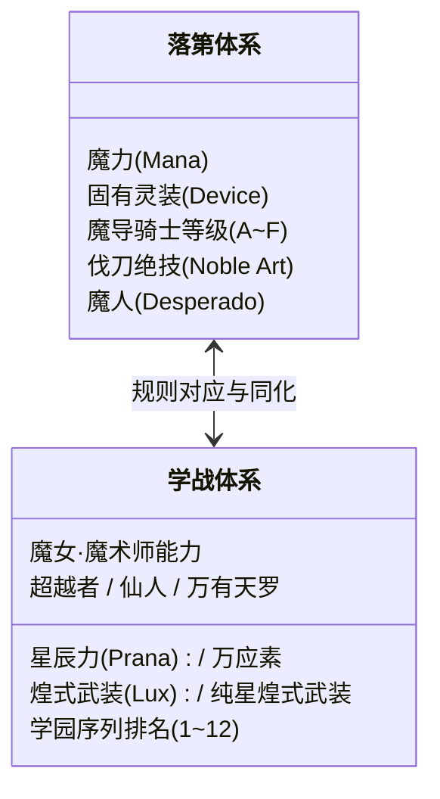

# 伐刀者与星脉世代能力体系对照表

> 标签：#交叉设定 #世界观换算 #战力映射 #落第x学战

在构建《落第骑士英雄谭》×《学战都市Asterisk》联合世界线时，两套战斗力与超常体系的映射换算逻辑如下：

| 维度项 | 《落第骑士英雄谭》体系 | 《学战都市Asterisk》体系 | 跨界融合自洽解释 |
| :--- | :--- | :--- | :--- |
| **基础能量** | **魔力 (Mana)**：来自伐刀者灵魂力量的具现化 | **星辰力 (Prana) + 万应素**：肉体储存星辰力，大气充斥万应素 | 魔力即为星辰力与万应素在伐刀者体内的高阶浓缩态。 |
| **武器载体** | **固有灵装 (Device)**：灵魂切片具现化出的冷兵器 | **煌式武装 / 纯星煌式武装**：万应矿人造武器或具有灵魂的原石兵器 | 纯星煌式武装相当于带有独立意志的上位灵装。 |
| **异能干涉** | **因果干涉系 / 自然干涉系** | **魔女 (Strega) / 魔术师 (Dante)** | 魔女直接调动环境万应素，等同于强力自然干涉系伐刀者。 |
| **境界顶点** | **魔人 (Desperado)**：突破命运锁链、脱离世界因果常理 | **万有天罗 (范星露) / 超规格超越者** | 范星露与爱德怀斯同属超脱生死因果的至高魔人层次。 |

---
关联条目：[[01_世界观与核心规则/星脉世代(Genestella)与魔女·魔术师|星脉世代]] | [[04_登场人物档案库/范星露|范星露]]
