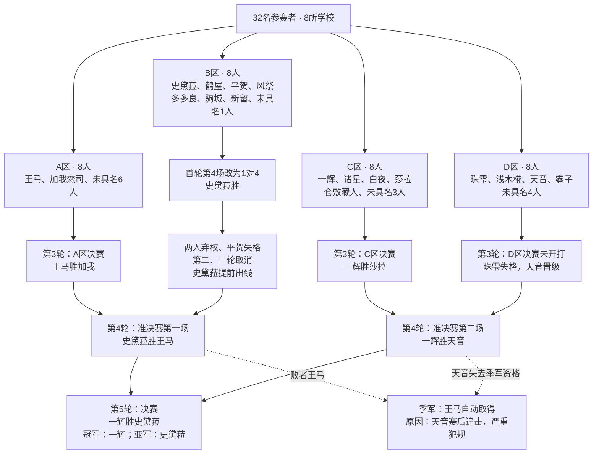
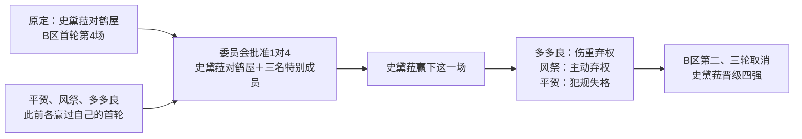
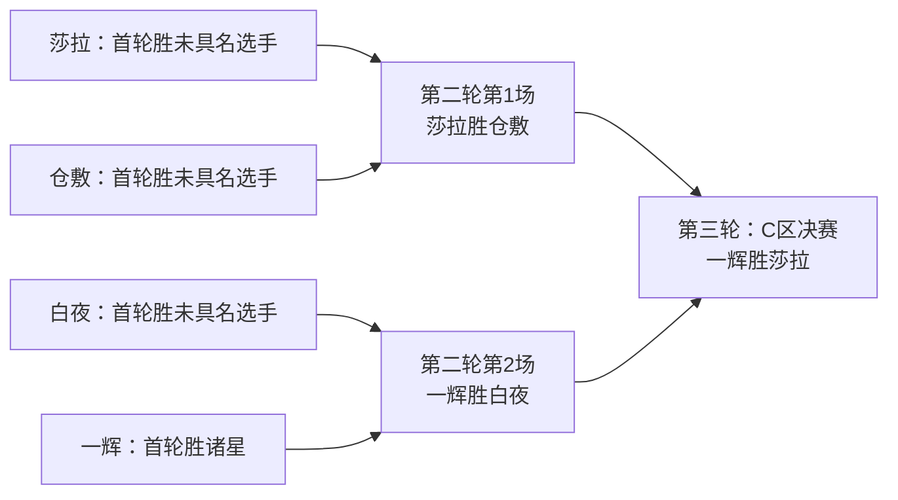
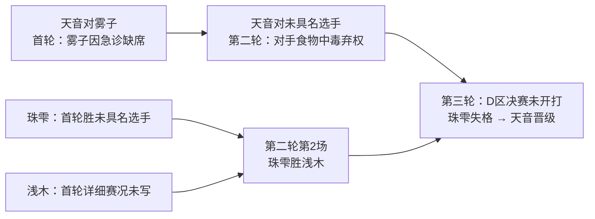

# 第62届七星剑武祭：32强分区与赛制

依据第五至第九卷本地小说核对。本文统一使用“七星剑武祭”；这是全国正赛，不是破军校内选拔赛。**本届8校32人，分A、B、C、D四区，按单败淘汰推进；四区胜者分别进入 A对B、C对D 的准决赛。**

## 先看晋级总图

每区8席由总人数、各区首轮四场及后续轮次共同复原。常规结构是：首轮4场 → 第二轮2场 → 第三轮区决赛1场 → 产生1名四强。分区是签表区块；没有依据把它们画成四个地理行政区或四座独立会场。卷6 L5373直接称C区为“登记的比赛区块”；卷5 L4657–4659、卷6 L2606–2608写同一战圈整顿后依次转入别区比赛。

图中是**原著实际结果**。B区特别战和D区失格晋级都不能算成正常打完该区三轮；季军也没有补画一场原文未描写的王马对天音。

## 32席能辨认到什么程度

以下按区列满32席，**表内编号仅供计数，不是官方抽签顺位，也不能据此把相邻两行配对**。目前能辨认18席，其中驹城、新留仅给姓氏；另外14席保留未具名。两名未知对手不能擅自合并，也不补造姓名、学园或能力。

| 展示席位 | A区 | B区 | C区 | D区 |
|---|---|---|---|---|
| 1 | 黑铁王马／晓 | 史黛菈·法米利昂／破军 | 黑铁一辉／破军 | 黑铁珠雫／破军 |
| 2 | 加我恋司／禄存 | 鹤屋美琴／巨门 | 诸星雄大／武曲 | 浅木椛／武曲 |
| 3 | 未具名A-1 | 平贺玲泉／晓 | 城之崎白夜／武曲 | 紫乃宫天音／晓 |
| 4 | 未具名A-2 | 风祭凛奈／晓 | 莎拉·布拉德莉莉／晓 | 药师雾子／廉贞 |
| 5 | 未具名A-3 | 多多良幽衣／晓 | 仓敷藏人／贪狼 | 未具名D-1 |
| 6 | 未具名A-4 | 驹城／文曲 | 未具名C-1 | 未具名D-2 |
| 7 | 未具名A-5 | 新留／廉贞 | 未具名C-2 | 未具名D-3 |
| 8 | 未具名A-6 | 未具名B-1 | 未具名C-3 | 未具名D-4 |

不要把诸星写成贪狼代表，或把加我写成武曲代表：卷5 L1229、L1249、L1345、L1479分别说明诸星、白夜／浅木、加我、仓敷的学园；驹城与新留见卷6 L385、L261。其余身份随各场入场介绍可核。

## 各区对阵路线

### A区：王马与加我在第三轮相遇

| 轮次 | 对阵／结果 | 依据 |
|---|---|---|
| 第一轮 | 王马胜未具名对手；加我也胜出。其余两场及具体签位未详。 | 卷6 L8–10；卷7 L3619–3633 |
| 第二轮 | 王马、加我各自晋级，对手未具名；不能把这一轮画成二人互战。 | 卷6 L5069结合卷7 L3459–3461、L3619–3633、L3687–3971 |
| 第三轮／区决赛 | 王马胜加我，王马晋级四强；加我受重伤后救回性命。 | 卷7 L3559、L3687–3971、L4083 |

卷6 L5069写“王马与加我恋司分出胜负”，孤立阅读容易误认为二人已经交手；卷7实际完整对决在第三轮。此处按后文明确的赛程还原为**二人各自的第二轮比赛结束**，不凭一句含混描述增加一场重赛。

### B区：特别赛与行政晋级必须分开

| 原定轮次／场次 | 原定对阵 | 实际情况 | 依据 |
|---|---|---|---|
| 第一轮第1、2场，二者顺序未定 | 平贺对未具名选手；风祭对驹城 | 平贺、风祭各胜出。 | 卷5 L8139–8141；卷6 L12、L54、L385 |
| 第一轮第3场 | 多多良对新留 | 多多良胜。 | 卷6 L261 |
| 第一轮第4场 | 史黛菈对鹤屋 | 延后后改为1对4；平贺、风祭、多多良作为特别成员加入鹤屋一方，史黛菈胜。 | 卷5 L4627–4647、L8219–8259；卷6 L2491–2501 |
| 第二轮第1场 | 平贺对风祭 | 未举行：风祭弃权，平贺因犯规失格。 | 卷6 L54、L2501、L5028–5036 |
| 第二轮第2场 | 史黛菈对多多良 | 未举行：多多良被医生判定不能比赛，随后提交弃权。 | 卷6 L2501、L5028–5038 |
| 第三轮／区决赛 | 上述两场的胜者 | 取消；史黛菈成为仅存的有效参赛者，提前晋级准决赛。 | 卷6 L5038–5042、L5173；卷7 L251–253 |

特别赛的批准条件：有关选手同意、委员会许可；史黛菈必须击败四人，鹤屋或任何特别成员击败史黛菈都算鹤屋获胜（卷5 L8219–8239）。这不是全赛事常设的“可任选多人围攻”规则，也不是一胜自动记三轮胜利。

### C区：一辉与莎拉在第三轮相遇

| 轮次／场次 | 对阵／结果 | 依据 |
|---|---|---|
| 第一轮第1、2场，二者顺序未定 | 莎拉、仓敷各胜未具名对手。 | 卷6 L5455–5457、L5479–5483、L5785；结合第二轮路线 |
| 第一轮第3场 | 白夜胜未具名对手；对手出场外，十秒未回。 | 卷5 L5271 |
| 第一轮第4场 | 一辉胜诸星。 | 卷5 L5263、L5393–5395、L7768–7794 |
| 第二轮第1场 | 莎拉胜仓敷。 | 卷6 L5479–5483、L5705–5707、L6577 |
| 第二轮第2场 | 一辉胜白夜。 | 卷6 L6826；卷7 L14–84 |
| 第三轮／区决赛 | 一辉胜莎拉，一辉晋级四强。 | 卷7 L4493–4559、L6235–6295、L6450 |

### D区：天音三次未正式交战便出线

| 轮次 | 对阵／结果 | 依据 |
|---|---|---|
| 第一轮 | 天音对雾子；雾子因急诊病患返回医院，天音不战而胜。珠雫另胜未具名对手。浅木及另一位后续选手的首轮具体赛况未详。 | 卷6 L2660–2668、L3054、L3090–3154、L3538–3540；卷7 L6530–6532 |
| 第二轮一场 | 天音对未具名选手；对手食物中毒弃权，天音不战而胜。 | 卷7 L6476、L6530–6532 |
| 第二轮第2场 | 珠雫胜浅木。 | 卷7 L193–243 |
| 第三轮／区决赛 | 珠雫赛前袭击天音失败，双方未正式入场；珠雫被判失格，天音晋级。 | 卷7 L6514–6598；卷8 L737–753 |

**首轮编号有疑点：**卷6 L3540称珠雫“D区第三场”，L2664与L3054称天音对雾子“D区第四场”；但卷6 L3624及卷7后续赛况都明确珠雫与天音在区决赛才相遇。卷6 EPUB `OEBPS/Text/Chapter002.xhtml` 也使用相同编号。无法确认这是出场顺序与签位不一致，还是原文编号问题；因此图中不把“第3场、第4场”强行接成第二轮相遇。

## 轮次与日期

| 阶段 | 常规人数变化 | 本届实际安排 |
|---|---|---|
| 第一轮 | 32→16 | 大赛第1天；8月7日为跨卷日序推算。B区特别赛在此轮。 |
| 第二轮 | 16→8 | 第2天09:00开始；8月8日为推算。B区取消，仅A、C、D区进行。 |
| 第三轮／区决赛 | 8→4 | 同日18:00开始，依次A、C、D区；B区已出线。第二轮结束时实际只剩7名选手，含早已晋级的史黛菈。 |
| 第四轮／准决赛 | 4→2 | 第3天，推算8月9日。先A–B，再C–D；两场之间休息30分钟清扫、维修。 |
| 第五轮／决赛 | 2→1 | 压缩赛程后原定8月10日；一辉获救苏醒后另准于翌日19:00举行，即8月11日19:00。 |
| 颁奖闭幕 | 冠、亚、季军 | 卷9写在决赛次日；王马自动获季军、缺席颁奖。没有实际季军战的描写。 |

依据：卷6 L5053–5057，卷7 L14、L243、L251–253、L3437–3461，卷8 L1140、L3301–3303、L6084–6098、L6330，卷9 L7430–7450。除原文明说的8月10日和各钟点外，公历日期均为跨段推算；不补造每场开赛时刻。

常规“一天一轮”被打破的原因：B区两轮没有史黛菈出场，引发转播商与赞助商压力，委员会退还部分播放权拍卖款、缩短一天赛程，原决赛日改排表演赛。后因一辉病危，决赛又顺延，表演赛提前；不能把这两次调整混成同一次（卷6 L5153–5229；卷9 L24–46）。

## 可作为规则使用的内容

| 规则 | 本次核实结论 | 原文依据 |
|---|---|---|
| 单败 | 输一次即结束争冠路线，不是循环积分赛。 | 卷5 L2072–2074 |
| 首轮轮空 | 本届因人数大幅减少，取消种子选手第一战免赛权；不等于原文证明所有抽签细则都永久改革。 | 卷5 L4695 |
| 通常对战人数 | 通常一对一；史黛菈1对4是历来首次、经批准的例外。 | 卷6 L32–36；卷5 L8219–8239 |
| 出界 | 主审开始场外计时，十秒内不能回到战圈则败；不是越线即输。 | 卷9 L5031–5033；卷8 L2076、卷9 L5381有实际返场例子 |
| 无法继续战斗 | 主审可直接判负。不能把场外十秒扩大成“所有倒地都要十秒”。 | 卷8 L3122、L4883–4889；卷9 L5947–5967 |
| 弃权／失格 | 可不战晋级，且原因要具体区分；不能把医学退赛、本人弃权、恶意犯规都称为擂台击败。 | 卷6 L2501、L5028–5038；卷8 L737–753 |
| 迟到 | 本次依规则顺延；委员会核实电车误点而免罚，再赶不上延后场次才退场。不能由此推成无限迟到。 | 卷5 L4627–4647 |
| 场外袭击／赛后追击 | 不属于被赛事认可的正常决斗；可导致失格、禁赛或奖项资格变化。 | 卷8 L737–745；卷9 L7448 |

不纳入规则：每校固定4席、晓学园仅4名、30人后改32、冠军自动获得A级执照、灵装破碎一律直接判负、所有正式赛必须使用某种型态。第五至九卷本次相关段落不足以支持这些旧稿说法；不能以训练中的〈幻想型态〉切换说明正式赛通则。

## 资料边界与源内差异

- **比赛总数：**标准32人单败树有31个对阵节点，但本届有特别赛、取消、不战晋级，不能写“实际打了31场”。卷9 L2533、L2569称决赛前25场，L7434称全部26场。原文没有逐项说明弃权与取消的计数口径，本文保留这个统计，不用它反造季军战或未知比赛。
- **日落／夜间：**卷9 L50回顾中写“接近日落”，与卷8明确的8月10日22:30醒来不合。时间表取卷8的钟表、日期和委员会通知，不编造抵达战圈的精确钟点。
- **人数与学园：**8校32名是本届到场正赛规模；参赛者曾大量弃权，晓学园也有6名可辨认参赛者。32÷8不能推出每校固定4名。七校与晓的完整名单见卷5 L4438–4454；弃权背景见L677。
- **玩家适配：**这是原著签表的整理。玩家替换某一席、促成退赛或改变胜负后，要更新整条晋级路径；不能继续把史黛菈、一辉、天音或王马锁进四强，也不能为了复刻特殊赛而替玩家同意1对4。

## 原文查证入口

行号统一为全卷1起物理行号，空行计入；原始GBK文件未修改。

- [第五卷UTF-8副本](核验记录/第五卷原文_UTF8.txt)
- [第六卷UTF-8副本](../../第六卷-世界书整理/核验记录/第六卷原文_UTF8.txt)
- [第七卷UTF-8副本](../../第七卷-世界书整理/核验记录/第七卷原文_UTF8.txt)
- [第八卷UTF-8副本](../../第八卷-世界书整理/核验记录/第八卷原文_UTF8.txt)
- [第九卷UTF-8副本](核验记录/第九卷原文_UTF8.txt)
- [原文哈希、编码及EPUB交叉核查记录](核验记录/原文来源.json)
