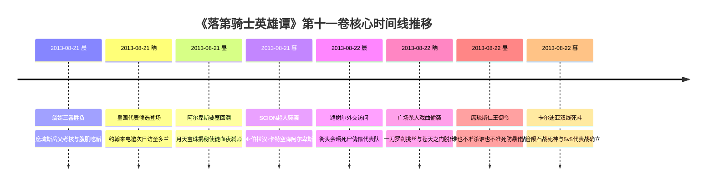

# 第十一卷卷内时间线：全量锚定与时序坐标

> **权威材料依据**：`落第骑士英雄谭 第十一卷 gbk.txt`（`MAT-011`，7,387 行全量原著正文）  
> **公历与赛程权威标准**：严格接续第十卷（西历 2013 年 8 月 20 日抵法米利昂提亲、同夜路榭尔惨案爆发）之日历推进。  
> **核心时间跨度**：**西历 2013 年 8 月 21 日（星期三）至 8 月 22 日（星期四）**，共计 2 日的欧洲局势骤变与战争全面爆发。  
> **事实状态标定**：`extracted`（原文显式字句确认）、`proposed`（卷内情节连续逻辑推导）。

---

## 一、 宏观战争时序与地缘背景

| 时间维度 | 原著显式判定 | 原文出处与行号 | 叙事与地缘定位 |
|---|---|---|---|
| **提亲次日** | **西历 2013 年 8 月 21 日（星期三）·清晨至正午** | 第五章 L10–L92 (`MAT-011#L10`)：“昨天甚至不愿意和席琉斯一起洗澡……这也只到今天为止。” | 承接第十卷 8月20日 突破亲卫队与举国广播次日；席琉斯在王宫中庭摆擂考核新女婿。 |
| **暗网反叛** | **三日前的弑师屠戮（约 8 月 18 日）与 8 月 21 日下午的现实调查** | 第六章 L1003 (`MAT-011#L1003`)：“三天前，这里的确发生了战争。” | 欧尔·格尔早于第十卷路榭尔惨案前清洗旧部，月影于 8月21日 下午在废墟通过〈月天宝珠〉回溯真相。 |
| **同盟介入** | **西历 2013 年 8 月 21 日（星期三）·傍晚 16:30 至 17:30** | 第六章 L1104–L1115 (`MAT-011#L1104`)：“洛克贝尔公司信天翁直升机，〈SCION〉亚伯拉汉·卡特……！！” | 极恶四人同盟成立后，美国超能力部队突袭阿尔卑斯，世界三大阵营均势破裂。 |
| **外交探查** | **西历 2013 年 8 月 22 日（星期四）·上午 11:00 至 13:00** | 第七章 L2059–L2723 (`MAT-011#L2059`)：承接第五章“明天上午去一趟奎多兰”之约定。 | 露娜艾丝、一辉、史黛菈搭机飞抵路榭尔，与死尸代表队相见。 |
| **战争爆发** | **西历 2013 年 8 月 22 日（星期四）·下午 13:00 至 14:30** | 第八章 L2724–L4272 (`MAT-011#L2724`)：路榭尔广场欧尔·格尔现身，全军压境宣战。 | 一辉一刀罗刹重创，黑骑士救场并以〈苍天之门〉传送回国；席琉斯下达防暴作战御令。 |
| **城镇血战** | **西历 2013 年 8 月 22 日（星期四）·下午 14:30 至黄昏 18:00** | 第九章 L4273–L7353 (`MAT-011#L4273`)：卡尔迪亚阵地战、王宫刺杀与代表战宣告。 | 宁音陨石硬撼沙漠死神，多多良电锯战艾茵；露娜艾丝引渡5v5代表战终止兵戎。 |

---

## 二、 卷内核心时间节点全量锚定（Anchor `T01` ～ `T08`）



---

### `T01` 西历 2013 年 8 月 21 日（星期三）·上午 09:00 至 11:30：翁婿三番胜负与女仆腹肌骚动
- **时间状态**：`extracted`（L10–L92 原文明确标定昨天刚到、今日开打）
- **章节范围**：`CH-05` 第五章（L3–L677）
- **核心事件**：
  1. 席琉斯因女儿史黛菈与妻子阿斯特蕾亚态度冷淡，迁怒一辉并于中庭训练擂台设下挑战；
  2. **第一战·灵装比试（L120–L208）**：席琉斯施展三千度〈炙焰大斧〉，一辉凭微细眼动识破席琉斯三十年前左眼失明旧创，施展比翼体术滑入死角，开局五秒轻取胜利；
  3. **第二战·比拼腕力（L209–L400）**：席琉斯以“三战两胜积分十倍”耍赖，铁桶腕力对决；一辉以一分钟内破除生存本能之极端身体掌控力，手臂如钢铁机器般缓慢沉稳压倒席琉斯粗壮双倍之臂；
  4. **第三战·限定甜点马拉松（L401–L560）**：沿干道奔赴十公里外“邦妮之家”总店购买限定巧克力鲷鱼烧；席琉斯抄近道巷弄彻底迷路致电求救，一辉率先购回鲷鱼烧三连胜，并坦言“若有了孩子绝不轻易放手”的担当，赢得岳母全力支持；
  5. **福利骚动（L574–L677）**：女仆递上冷饮，一辉脱去被汗水浸透的上衣露出精壮如刀刻的分块腹肌与纤细猛男体格；女仆群尖叫起哄邀其去宿舍淋浴喝茶，史黛菈醋意大发、红发燃火咆哮追赶女仆。
- **出场人物**：`char-ikki-kurogane`、`char-stella-vermillion`、`char-sirius-vermillion`、`char-astrea-vermillion`、王宫女仆群
- **地点**：法米利昂王宫中庭擂台、皇都干道南侧、“邦妮之家”甜点总店
- **来源**：`MAT-011#L8-L677`

---

### `T02` 西历 2013 年 8 月 21 日（星期三）·正午 12:00 至 12:30：皇国代表候选登场与约翰邀约电话
- **时间状态**：`extracted`
- **章节范围**：`CH-05` 第五章（L678–L925）
- **核心事件**：
  1. 第一皇女露娜艾丝率皇国代表选手堤米特·格雷希（活泼少女）与米利雅莉亚·雷吉（媚气少女）现身，说明两人在代表战中需要一辉特训；
  2. 奎多兰第一王子〈黄金风暴〉约翰·克里斯多夫·冯·柯布兰德致电露娜艾丝；
  3. 约翰借口“国际联盟通报〈解放军〉重犯欧尔·格尔潜伏两国边境、战争开幕在即国民往来激增”，邀请来自远东击败红莲皇女的黑铁一辉于“明天上午”访问奎多兰首都路榭尔举行代表防务会商；露娜艾丝欠约翰特批代表名额人情，请求一辉明日同行。
- **出场人物**：`char-ikki-kurogane`、`char-stella-vermillion`、`char-lunaize-vermillion`、`char-dimitrie-greishi`、`char-miliaria-regi`、`char-john-christoph`（电话中）
- **地点**：法米利昂王宫中庭
- **来源**：`MAT-011#L678-L925`

---

### `T03` 西历 2013 年 8 月 21 日（星期三）·下午 14:00 至 16:30：阿尔卑斯使徒惨剧回溯
- **时间状态**：`extracted`（L1003 原文明示“三天前这里发生了战争”）
- **章节范围**：`CH-06` 第六章（L926–L1060）
- **核心事件**：
  1. 风祭财团直升机降落瑞士阿尔卑斯山脉深谷，群山山峰皆遭利刃削平；风祭晄三现身，迎接女儿风祭凛奈、莎拉·布拉德莉莉、女仆夏洛特与日本内阁总理大臣月影貘牙；
  2. 月影施展固有灵装〈月天宝珠〉回溯三日前（约 8月18日）地下总部惨案：
     - 欧尔·格尔哼唱童谣《Row, Row, Row your boat》，以傀儡线让外围守卫士兵互相开枪、割喉自尽；
     - 欧尔·格尔徒手推开20吨铁门，硬抗密集重火力弹幕，以〈杀人戏曲〉将50名精锐守军斩为肉块；
     - 〈独腕剑圣〉华伦斯坦拔巨剑惩戒逆徒，欧尔·格尔制成石人偶围殴；华伦斯坦以〈开山斩〉削峰劈偶，支配“摩擦力”使地面与丝线无法受力，并踢碎欧尔·格尔内脏将其逼入绝境；
     - 华伦斯坦欲枭首欧尔·格尔时，潜伏其体内的〈沙漠死神〉纳西姆·萨利姆伸出漆黑手臂，撕裂肋骨掏出心脏抽干水分成番茄干，将华伦斯坦吸成干尸木乃伊；
     - 〈恶之华〉艾茵·阿伯伦特与心智五岁的巨汉〈B·B〉自地下步出，展示将7名十二使徒高官变成生体开花肥料尸体的惨状；
     - 欧尔·格尔宣称厌倦组织，只想弄脏史黛菈高贵心灵，与追求建国的纳西姆、渴求肥料的艾茵、B.B结成侵略同盟。
- **出场人物**：`char-bakuga-tsukikage`、`char-kouzo-kazamatsuri`、`char-rinna-kazamatsuri`、`char-sarah-bloodlily`、`char-charlotte-corday`、`char-or-gaule`（回溯）、`char-wallenstein`（回溯）、`char-nassim-salim`（回溯）、`char-eine-aberrant`（回溯）、`char-bb-big-baby`（回溯）
- **地点**：瑞士·阿尔卑斯山脉地下防空要塞
- **来源**：`MAT-011#L926-L1060`

---

### `T04` 西历 2013 年 8 月 21 日（星期三）·傍晚 16:30 至 17:30：SCION超人突袭与均势崩溃
- **时间状态**：`extracted`
- **章节范围**：`CH-06` 第六章（L1061–L1133）
- **核心事件**：
  1. 月影回溯结束，与晄三判定欧尔·格尔以平贺玲泉之身接触史黛菈后私自行动，法米利昂已成目标；
  2. 莎拉欲拨打一辉手机报警，月影欲联络联盟总部次长〈白翼宰相〉诺曼·克里德，通讯网络全面遭到物理压制屏蔽；
  3. 信徒急报：西北方瞭望哨侦测到三架以三倍超音速疾驰而来的洛克贝尔信天翁式武装直升机，隶属于大国同盟（Union）美国超能力特种部队〈SCION〉，领军者为大国同盟最强男人——〈超人〉亚伯拉汉·卡特；
  4. 晄三长叹“诸事无常，对不起了龙马”，世界三大阵营（联盟、同盟、解放军）均势彻底破裂。
- **出场人物**：`char-kouzo-kazamatsuri`、`char-bakuga-tsukikage`、`char-rinna-kazamatsuri`、`char-sarah-bloodlily`、`char-abraham-carter`（逼近中）
- **地点**：阿尔卑斯山脉解放军要塞停机坪
- **来源**：`MAT-011#L1061-L1133`

---

### `T05` 西历 2013 年 8 月 22 日（星期四）·上午 11:00 至 13:00：访问奎多兰与广场傀儡狂欢
- **时间状态**：`extracted`（L922 明天上午之行兑现）
- **章节范围**：`CH-07` 第七章（L2059–L2723）
- **核心事件**：
  1. 露娜艾丝、一辉、史黛菈搭乘皇室专用小型客机抵达奎多兰首都路榭尔专机坪，乘加长礼车赴中央大道；露娜艾丝讲述三十年前席琉斯单枪匹马闯入奎多兰化解世仇的往事；
  2. **广场碰头（L2190–L2270）**：金发约翰王子在约定时间前30分钟到达；露娜艾丝严肃上前为其整理歪斜领巾，指正其对一辉态度过于谦卑；
  3. **松饼之宴（L2271–L2440）**：史黛菈腹鸣如雷，众人前往路榭尔国立竞技场旁中央公园摊贩；一辉察觉人群中有一处不自然“空洞”，以五感捕捉到微服潜伏侦查的异色瞳银发女子（〈黑骑士〉阿斯卡里德）；史黛菈狂吃草莓超量松饼与巧克力松饼；
  4. **四名代表（L2441–L2570）**：奎多兰代表队路克（矮小发尖、好斗）、蜜拉（短发女）、里德与新婚妻子艾娜莉丝现身打招呼；路克出言挑衅一辉是野蛮部落入赘者，一辉以钢铁意志拔剑气魄反驳；
  5. **国境警报与终末宣告（L2571–L2723）**：市民举行即兴宴会；同时间法米利昂国境向日葵农场农妇目击奎多兰上百辆装甲坦克开赴边境；史黛菈在广场张开双臂宣告誓死守护两国人民，头顶半空突降欧尔·格尔冰冷嗤笑：“抱歉，你办不到的。”
- **出场人物**：`char-ikki-kurogane`、`char-stella-vermillion`、`char-lunaize-vermillion`、`char-john-christoph`、`char-luke-knight`、`char-mira-knight`、`char-reed-knight`、`char-annalise-knight`、`char-ascarid-iris`、`char-or-gaule`
- **地点**：奎多兰首都路榭尔中央广场、中央公园、国境向日葵花田
- **来源**：`MAT-011#L2059-L2723`

---

### `T06` 西历 2013 年 8 月 22 日（星期四）·下午 13:00 至 14:15：杀人戏曲偷袭、一刀罗刹强破与苍天之门脱出
- **时间状态**：`extracted`
- **章节范围**：`CH-08` 第八章（L2724–L3713）
- **核心事件**：
  1. 欧尔·格尔倒挂丝线打响指施放死网绝技〈杀人戏曲〉；一辉在时间几乎停滞的极端专注中撞开史黛菈，怒吼爆发【一刀罗刹】由下而上挥出阴铁，斩碎路灯树木并将上千斩击挑飞至半空，护住全场所有人，但全身毛孔撕裂大出血倒在血泊中昏厥；
  2. 约翰拔出骑兵枪〈黄金战车〉发动奥义〈蹄轹王道〉突刺并将史黛菈关节锁死在地，空洞眼神不断呢喃“对不起”；
  3. 广场市民受丝线操控在鸽血中唱歌跳舞；欧尔·格尔揭秘路克、蜜拉、里德、艾娜莉丝四人早被约翰所杀，四具尸体如断线木偶面容扭曲倒地、七孔溢出黑血；
  4. 露娜艾丝持匕首冲刺被丝线勒颈悬空；欧尔·格尔吐露纯粹以虐杀玩弄人心为乐的变态执念，宣告傀儡大军正全面入侵法米利昂；
  5. 史黛菈以〈龙神附身〉巨龙怪力强行扯断丝线飞扑劈斩，欧尔·格尔提线掷出一辉作为肉盾；史黛菈斩击无法收回之际，〈黑骑士〉阿斯卡里德显现〈无敌甲胄〉护下一辉，挥动战斧斩断欧尔·格尔右手前臂；
  6. 欧尔·格尔喊出“艾莉丝姊姊”，释放遮天蔽日的魔人黑雾；阿斯卡里德取出联盟次长诺曼·克里德的传送灵装〈苍天之门〉短刀刺入地面，白光爆闪将阿斯卡里德、史黛菈、昏迷的一辉与露娜艾丝瞬移回法米利昂弗雷雅维格中央公园；
  7. 阿斯卡里德以甲胄治愈一辉肉体创伤，自己却因童年梦魇双膝跪地、浑身发冷战栗；一辉脱下头盔轻抚其背脊安抚，承诺严守秘密。
- **出场人物**：`char-ikki-kurogane`、`char-stella-vermillion`、`char-lunaize-vermillion`、`char-or-gaule`、`char-john-christoph`、`char-ascarid-iris`
- **地点**：路榭尔中央广场 $\to$ 法米利昂皇都弗雷雅维格中央公园
- **来源**：`MAT-011#L2724-L3713`

---

### `T07` 西历 2013 年 8 月 22 日（星期四）·下午 14:15 至 15:00：席琉斯国王防暴御令与卡尔迪亚窄巷战术
- **时间状态**：`extracted`
- **章节范围**：`CH-08` 第八章（L3714–L4272）
- **核心事件**：
  1. 皇都警报大作，史黛菈以龙之概念幻化火焰羽翼飞越外墙撞碎玻璃冲入皇宫；
  2. 席琉斯与阿斯特蕾亚迎上；阿斯特蕾亚基于政治理性主张绝不可将“敌军全为受控傀儡”告知前线，以免士兵不忍开枪招致法米利昂军队毁灭；
  3. 席琉斯怒砸石柱轰碎大厅石墙，抄起电话直接打给皇国陆军上将席格娜·艾隆，下达震撼全军的国王御令：“法米利昂将情义摆在道理之前！谁也不准杀！谁也不准死！全军装备非致命防暴武器救助邻邦！”
  4. 露娜艾丝因缺氧性脑病变与脚伤送医；阿斯卡里德带一辉入宫，指出欧尔·格尔以数百名傀儡作为神经“中继站”操纵万人大军，常规兵力无法甄别；
  5. 一辉伤愈挺身进言：利用卡尔迪亚市狭窄曲折的石造街巷设立阻击防线，限制敌军开阔地人数优势，并由高感知骑士深入窄巷专门拔除中继节点！
- **出场人物**：`char-stella-vermillion`、`char-sirius-vermillion`、`char-astrea-vermillion`、`char-daniel-dandalion`、`char-ikki-kurogane`、`char-ascarid-iris`、`char-signa-airon`（电话中）
- **地点**：法米利昂皇宫指挥大厅
- **来源**：`MAT-011#L3714-L4272`

---

### `T08` 西历 2013 年 8 月 22 日（星期四）·下午 15:00 至 18:00：卡尔迪亚双线死斗与五对五代表战引渡
- **时间状态**：`extracted`
- **章节范围**：`CH-09` 第九章（L4273–L7353）
- **核心事件**：
  1. **卡尔迪亚防暴阻击（L4273–L5190）**：皇国陆军装备防暴盾、橡胶弹与电击枪，在窄巷死守；一辉、史黛菈、阿斯卡里德与丹达利昂穿插战线精准制伏中继节点，阿斯卡里德以肉身无敌甲胄硬接火箭弹；
  2. **王宫毒花奇袭与席琉斯受戮（L5191–L6445）**：〈恶之华〉艾茵潜入皇宫释放深色魔花甜腻花粉，皇家卫士尽数神经麻痹；艾茵步入王座大厅直面席琉斯与阿斯特蕾亚，以带刺荆棘灵装〈阿斯塔萝黛〉高速抽打，残忍挑断席琉斯双肩与双腿全部四肢肌腱，踩在脚下欲作生体肥料；
  3. **女仆电锯救场（L6446–L6650）**：王宫女仆多多良幽衣（暗狱之家四号菲亚）破门暴起，轰鸣链锯灵装〈掠地蜈蚣〉斩碎荆棘，同门师姐妹展开生死厮杀；
  4. **沙漠死神与夜叉姬陨石战（L5630–L6270, L6651–L7260）**：卡尔迪亚战场突降心智五岁的巨汉B.B疯狂砸楼；〈沙漠死神〉纳西姆施展人形天灾能力“Haboob（干涸）”，瞬间抽干地壳水分化为流沙，引发卡尔迪亚西区大塌陷；关键时刻破军兼任教师、KOK世界第三〈夜叉姬〉西京宁音以〈霸道天星〉牵引20米天外陨石从天而降砸中纳西姆！宁音以漆黑重力场实打沙身、撕破衣襟踢碎建筑，纳西姆震怒暴走；
  5. **黄金战车降临与全权停战声明（L7261–L7353）**：两名魔人全力碰撞前夕，天上巨斩阻隔战圈；欧尔·格尔携约翰与第一皇女露娜艾丝骑乘〈黄金战车〉降临半空；欧尔·格尔下令艾茵撤手；
  6. **露娜艾丝大义决断**：露娜艾丝行使国王全权，代表法米利昂正式接受奎多兰宣战，但按照联盟公约改以“五对五魔法骑士代表战”定胜负，并合法全面拒绝国际魔法骑士联盟派遣百万大军介入！保全两国数百万被控军民免遭屠戮。
- **出场人物**：`char-signa-airon`、`char-ikki-kurogane`、`char-stella-vermillion`、`char-ascarid-iris`、`char-daniel-dandalion`、`char-nassim-salim`、`char-bb-big-baby`、`char-nene-saikyo`、`char-eine-aberrant`、`char-sirius-vermillion`、`char-yui-tatara`、`char-or-gaule`、`char-lunaize-vermillion`
- **地点**：卡尔迪亚市城门阻击防线、卡尔迪亚西区废墟、法米利昂王宫王座大厅
- **来源**：`MAT-011#L4273-L7353`

---

## 三、 跨卷承接与日历演进对照表

```text
【第十卷终局：法米利昂提亲与路榭尔血夜】
2013-08-20（二）晨: 一辉专机抵法米利昂，突破50人亲卫队与教会丹达利昂，见岳父，举国广播 (卷十 T05)
2013-08-20（二）夜: 奎多兰歌剧院特训场惨案；欧尔·格尔夺舍约翰屠戮玷污代表队、开启战役 (卷十 T06)
   │
   ▼（日历无缝衔接）
【第十一卷前段：中庭考验与暗网崩溃】
2013-08-21（三）晨: 席琉斯中庭考核新女婿（5秒识破旧疾、腕力碾压、鲷鱼烧马拉松、腹肌吃醋） (卷十一 T01)
2013-08-21（三）昼: 堤米特与米利雅莉亚登场；约翰来电邀约“明日上午访路榭尔” (卷十一 T02)
2013-08-21（三）昼: 阿尔卑斯使徒总部调查；月天宝珠回溯三日前纳西姆弑师华伦斯坦与极恶同盟 (卷十一 T03)
2013-08-21（三）暮: 美国SCION部队亚伯拉汉·卡特乘3架超音速信天翁突袭阿尔卑斯，均势破裂 (卷十一 T04)
   │
   ▼（次日上午，约定兑现）
【第十一卷后段：路榭尔陷阱与卡尔迪亚双线死斗】
2013-08-22（四）晨: 露娜、一辉、史黛菈赴路榭尔会晤约翰与四名死尸代表；史黛菈吃松饼誓死守护 (卷十一 T05)
2013-08-22（四）晌: 杀人戏曲爆发；一辉一刀罗刹重创昏厥；黑骑士斩欧尔·格尔手臂，苍天之门撤回 (卷十一 T06)
2013-08-22（四）昼: 史黛菈火翼飞入皇宫；席琉斯怒砸石柱下达“非致命防暴作战、谁也不准死”御令 (卷十一 T07)
2013-08-22（四）暮: 卡尔迪亚城镇战：防暴盾推进行；纳西姆沙化地壳、夜叉姬宁音陨石砸落；
                    王宫艾茵挑断席琉斯四肢肌腱，多多良幽衣电锯救场；
                    露娜艾丝降临宣布接受宣战、引渡5v5代表战封锁百万联盟军队 (卷十一 T08)
```
