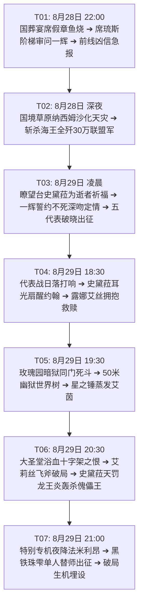

# 第十三卷卷内时间线：全量锚定与时序坐标

> **权威材料依据**：`落第骑士英雄谭 第十三卷 gbk.txt`（`MAT-013`，6,518 行全量原著正文，交叉核验 `[台版]落第骑士英雄谭 13.epub`）  
> **时间规范原则**：严格基于原著显式时间词、比赛场次推移、昼夜进程与战斗相对间隔，不捏造虚假公历年月日。  
> **事实状态标定**：`extracted`（原文显式字句确认）、`proposed`（卷内情节连续逻辑推导）。

---

## 一、代表战开战宏观进程与战况总览

| 战区位置 | 对阵双方 | 战术机理与战况进程 | 胜负与结局 |
|---|---|---|---|
| **国境阻击战**（开战前夜） | **〈沙漠死神〉纳西姆·萨利姆 VS 〈海王〉卡罗·贝托尼 / 联盟30万进击军** | 纳西姆发动荒漠化概念干涉抽干水分化作木乃伊；卡罗以〈第八大海〉与冰枪反击被纳西姆强行喝干大海，头骨遭如捏番茄般捏碎 | **纳西姆·萨利姆 胜**（海王战死，三十万联军溃灭） |
| **王都主干道战场**（代表战第1战） | **黑铁一辉 VS 〈B·B〉（三百米改造巨婴）** | 一辉以制服外套为伞缓冲，钻入巨人指缝与肚脐凹陷闪避；滑铲斩断阿基里斯腱与股四头肌，第一秘剑〈犀击〉刺破太阳穴击穿运动中枢；暖掌唤醒童年记忆 | **黑铁一辉 胜**（B.B缩小陷入深眠，一辉毫发无损完美首胜 1:0） |
| **王都空域战场**（代表战第2战） | **史黛菈·法米利昂 VS 〈黄金风暴〉约翰·克利斯多夫（欧尔·格尔提线傀儡）** | 约翰被傀儡丝超频自残冲锋；史黛菈明悟意志压制，收回罪剑空手硬接〈蹄砾王道〉夺枪，娇叱露娜托付一记惊天耳光将约翰抽飞撞塌七栋房屋；露娜艾丝亲赴战场唤醒誓约，约翰拼死扯断傀儡丝改幻想形态刺入腹部，露娜忍剧痛紧紧拥抱救赎 | **史黛菈·法米利昂 胜**（约翰脱困被救护班接离，开战十分钟法米利昂 2:0 梦幻开局） |
| **王城玫瑰园战场**（代表战第3战） | **多多良幽衣（四号菲亚） VS 〈恶之华〉艾茵·阿伯伦特（一号艾茵）** | 艾茵生化魔树荆棘灌喉折磨，幽衣〈因果报应〉反击；艾茵解放50米〈幽狱世界树〉；幽衣服禁药〈天使碎尘〉，偏转地球绕日公转动能轰出〈星之锤〉 | **多多良幽衣 惨胜**（艾茵与世界树彻底蒸发湮灭；幽衣失聪盲目断肢昏迷） |
| **住宅区与圣堂战场**（代表战第4战） | **艾莉丝·阿斯卡里德 & 史黛菈·法米利昂 VS 〈傀儡王〉欧尔·格尔** | 艾莉丝见毛毡人偶再现〈浴血十字架〉惨剧，以无敌甲胄硬抗遭欧尔·格尔反制窒息绞杀；艾莉丝舍身掷飞战斧为信标；史黛菈火翼神降释放〈燃天焚地龙王炎〉天火神罚 | **史黛菈 & 艾莉丝 胜**（史黛菈高空斩落天火神罚彻底轰杀欧尔·格尔） |
| **王都正门崩溃极光区**（跨卷进行中） | **〈夜叉姬〉西京宁音 VS 〈沙漠死神〉纳西姆·萨利姆** | 纳西姆开局〈化骸尘暴〉掀飞正门，宁音以百倍重力〈地缚阵〉正面硬撼；铁扇与漆黑拳套对轰激起毁灭性黑色极光与冲击波（战局延续至第十四卷） | **激战中**（顶尖魔人跨卷死斗） |

---

## 二、卷内核心时间节点全量锚定（Anchor `T01` ～ `T07`）

---

### `T01` 国葬狂欢与翁婿试炼·前线凶信突至
- **时间坐标**：西历 2013 年 8 月 28 日（星期三）·夜间 22:00～23:30
- **时间状态**：`extracted`
- **章节范围**：间章《凶信》（L3–L381）
- **核心事件**：
  1. 法米利昂皇都弗雷雅维格中央公园高架巨木篝火，国民通宵宴饮狂欢悼念卡尔迪亚阵亡将士。国民端上带触手的外星卵形“假章鱼烧”，史黛菈娇嗔护夫为日本美食正名；西京宁音大口扫盘豪饮啤酒，大醉迷离误认史黛菈为五胞胎。
  2. 一辉独坐步道阶梯，席琉斯国王手持烈酒现身，阐明法米利昂“存活者必须放声欢笑，不让死者抱愧”的生死美学；随后席琉斯红髯怒张挥拳质问一辉在雪山阻截比翼坐视史黛菈濒死之罪，巨拳在一辉鼻尖一厘米处硬生生刹住。一辉坦陈“正因深爱才不能破坏她贯彻自我面对悔恨的尊严”；席琉斯虽不赞同但承诺践诺，勒令一辉用手中之剑赢回女儿。
  3. 王后阿斯特蕾亚提裙惊惶奔至，通报联盟总部传来的前线绝密凶信，全场陷入极度震动。
- **出场人物**：史黛菈、黑铁一辉、席琉斯国王、阿斯特蕾亚王后、西京宁音、米莉、亚娜阿姨等国民群。
- **核心地点**：法米利昂皇都·弗雷雅维格中央公园国葬宴席、步道阶梯。

---

### `T02` 边境沙暴天灾·海王陨落与三十万军覆灭
- **时间坐标**：西历 2013 年 8 月 28 日（星期三）·深夜 23:30～8 月 29 日凌晨 03:00
- **时间状态**：`extracted`
- **章节范围**：第十五章《月下乱斗》前半（L382–L1539）
- **核心事件**：
  1. 联盟调集百万大军围困奎多兰国境，波兰老将达留葛率三十万精锐大军（含五千伐刀者师团、战车装甲师与战斗机部队）于波奎国境草原压境，意图在代表战爆发前以人海战术强攻解救三千人质。
  2. 满月之下，觉醒魔人〈沙漠死神〉纳西姆·萨利姆孤身立于山丘发出最后通牒，遭达留葛傲慢拒绝；纳西姆拔刀解放概念干涉，掀起遮天蔽日的荒漠化沙暴，战车战机瘫痪，数万将士体内水分被瞬间抽干化作干尸木乃伊，三十万精锐全线溃灭。
  3. 意大利最强骑士、KOK世界第二、史上最强水术士〈海王〉卡罗·贝托尼赶赴战场，刺枪引动万丈狂泉构筑浮空汪洋水牢〈第八大海〉，以极速水战和冰枪重创纳西姆；然而纳西姆悍不畏死狂笑蒸发巨海，在近身混乱中以鬼神臂力如捏烂番茄般生生捏碎了卡罗的头骨！世界第二当场战死，联军前锋覆灭。
  4. 纳西姆吐出内伤血痰点燃香烟，欧尔·格尔通过傀儡丝线中性嗓音连线，揭示联盟在两国周边已实质瓦解且深陷全球逃狱暴乱无法调兵；纳西姆凶残警告其不得搅局，俯瞰流沙地狱中沉睡的三十万无碑沙棺，放声狂笑将〈夜叉姬〉西京宁音宣告为自己不可侵犯之专属猎物。
- **出场人物**：纳西姆·萨利姆、卡罗·贝托尼、达留葛司令、联盟军参谋与将士群。
- **核心地点**：横跨波兰与奎多兰国境交界草原。

---

### `T03` 瞭望台逝者祈福·不死誓约与月下深吻
- **时间坐标**：西历 2013 年 8 月 29 日（星期四）·凌晨 03:00～06:00
- **时间状态**：`extracted`
- **章节范围**：第十五章《月下乱斗》后半（L1298–L1942）
- **核心事件**：
  1. 国葬宴席渐歇，史黛菈独伫公园瞭望台朝奎多兰方向闭目祈福一分钟哀悼阵亡将士。一辉走上台阶，史黛菈坦言已获悉海王战死与联军惨败；面对不可抗拒的魔人天灾，史黛菈虽毫无惧意，却极度害怕失去一辉，低声劝其退出留守法米利昂。
  2. 一辉双手轻捏史黛菈软乎乎的脸颊打断沉重，坚毅反驳“深爱之人的故乡与家人受难，自己挺身而出的理由数不胜数”；一辉一把将颤抖的史黛菈拥入怀中，许下铿锵誓言：“我不会输，绝对不会死在战场上……你的身边就是我的归处，我不会把这个位置让给任何人！”
  3. 史黛菈动情仰望，两人在清冷月光下深情相吻，所有恐惧烟消云散。远处宁音痛饮高歌，艾莉丝默默练习战斧挥砍，幽衣叼着点心凝望艾莉丝；破晓朝阳升起，五位代表乘机出征路榭尔。
- **出场人物**：史黛菈、黑铁一辉、西京宁音、艾莉丝·阿斯卡里德、多多良幽衣。
- **核心地点**：弗雷雅维格中央公园瞭望台、法米利昂战备停机坪。

---

### `T04` 代表战日落开幕·惊天耳光与断线救赎
- **时间坐标**：西历 2013 年 8 月 29 日（星期四）·日落 18:30～19:30
- **时间状态**：`extracted`
- **章节范围**：第十六章《王都开战》（L1943–L3833）
- **核心事件**：
  1. 日落战钟敲响，奎多兰首都路榭尔全境爆发 5v5 代表战，全球卫星实时直播。纳西姆发动〈化骸尘暴〉掀飞正门，西京宁音以百倍重力〈地缚阵〉正面硬撼纳西姆，两大魔人激战爆发黑色极光遮蔽镜头；其余四人抛飞千米高空，一辉以制服为降落伞从容落地，钻入指缝与肚脐闪避，斩断阿基里斯腱与股四头肌，第一秘剑〈犀击〉击破三百米巨婴 B.B 运动中枢，暖掌唤醒童年父母记忆斩获首胜（1:0）。
  2. 约翰·克利斯多夫踏着黄金战车自王城屋顶踏空飞袭史黛菈；史黛菈察觉约翰双眸空洞、四肢淌血，正被欧尔·格尔以傀儡丝透支自残冲锋。史黛菈明悟意志压制，收回灵装赤手空拳硬接〈蹄砾王道〉骑枪，将昨夜姐姐托付的真情咆哮化作惊天耳光将约翰抽飞撞塌郊外七栋房屋。
  3. 露娜艾丝亲赴硝烟焦土废墟，背对夕阳呼唤恋人；约翰以对露娜艾丝的极致爱意爆发出抗争奇迹，拼死硬生生扯断了欧尔·格尔的傀儡丝，全身体表撕裂七窍流血，在最后一刻切换幻想形态刺入露娜艾丝腹部。露娜艾丝忍剧烈幻痛飞奔上前将浑身是血的约翰紧拥入怀，救护班迅速将约翰接出战场；艾莉丝在住宅区见毛毡玩偶迎战欧尔·格尔，幽衣在玫瑰园锯断茶桌迎战艾茵；开战十分钟法米利昂连下两城 2:0 梦幻开局，史黛菈火翼锁定蜘蛛巢穴直扑主谋。
- **出场人物**：史黛菈、约翰·克利斯多夫、露娜艾丝·法米利昂、黑铁一辉、纳西姆、西京宁音、B.B、欧尔·格尔、布马主播。
- **核心地点**：奎多兰首都路榭尔全境、王都高空、郊外民居瓦砾废墟。

---

### `T05` 暗狱同门死斗·幽狱世界树与〈星之锤〉蒸发
- **时间坐标**：西历 2013 年 8 月 29 日（星期四）·夜间 19:30～20:30
- **时间状态**：`extracted`
- **章节范围**：第十七章《不转杀手》（L3834–L5632）
- **核心事件**：
  1. 王城玫瑰园中，暗狱首席艾茵优雅品茶，以多嘴郁金香、戳刺青竹等慢速生化攻击克制幽衣瞬间反射，以荆棘灌喉实施非人折磨；幽衣启动高阶因果技〈因果报应〉，将全身创伤因果加倍反噬艾茵，艾茵大口喷血。
  2. 暴怒的艾茵唤醒植入子宫的灵装〈阿斯塔萝黛〉，身躯化为高达五十公尺的魔界巨木〈幽狱世界树〉，释放狂暴玫瑰群兽；世界树以绝对质量碾碎幽衣的反弹判定，树根抽碎骨骼将幽衣重创轰飞。
  3. 幽衣回忆暗狱地狱中艾茵赠予的融化巧克力信念，誓死捍卫刺客信誉，咬碎暗狱禁药〈天使碎尘〉过载神经，浑身浴血突破五十米死线！在巨枝拍落刹那，幽衣将链锯刺入树干，发动终极绝技〈星之锤〉——微观偏转【地球绕日公转动能（秒速30公里）】导入世界树，毁天灭地的纯白光暴瞬间将五十米巨木、王城中庭与艾茵彻底蒸发湮灭为万丈深渊天坑！
  4. 幽衣在自爆余波中勉强存活，耳膜震穿失聪、单眼失明、手臂残废陷入深度休克，被医疗班紧急运走。
- **出场人物**：多多良幽衣（四号菲亚）、艾茵·阿伯伦特（一号艾茵）、布马主播。
- **核心地点**：奎多兰王城皇家玫瑰园 ➔ 星之锤蒸发天坑废墟。

---

### `T06` 浴血十字架之仇·飞斧破局与天罚龙王炎
- **时间坐标**：西历 2013 年 8 月 29 日（星期四）·夜间 20:30～21:30
- **时间状态**：`extracted`
- **章节范围**：第十八章《狂飙突进》（L5633–L6421）
- **核心事件**：
  1. 揭秘绝密档案〈浴血十字架〉惨案：欧尔·格尔十岁教堂操纵全村互残并逼迫幼年艾莉丝弑亲，前长官雷薇·阿斯卡里德以严厉慈悲收养并培养其为黑骑士；
  2. 现实大圣堂废墟中，艾莉丝以〈无敌甲胄〉硬抗蜘蛛网；欧尔·格尔利用艾莉丝曾败于海王的不死窒息弱点，以傀儡丝借其自身蛮力死死勒入气管实施窒息绞杀；艾莉丝顶着剧痛舍身掷出黑曜战斧，劈碎欧尔·格尔锁骨并掐住其咽喉；
  3. 欧尔·格尔趁艾莉丝缺氧痉挛以脚趾扯线使地面倾斜脱逃，踏着蛛网向天空飞窜企图疗伤；
  4. 万米高空之上，已经斩落约翰的〈红莲皇女〉史黛菈身负烈火巨翼破云而降，宣读女王死刑判词：“这世上绝对有人死了对全世界都好……欧尔·格尔，你就是这种人！”史黛菈出鞘黄金真剑斩落天罚奥义〈燃天焚地龙王炎〉，将蛛网上的丑陋恶魔彻底从高空轰碎贯穿！
- **出场人物**：艾莉丝·阿斯卡里德、欧尔·格尔（傀儡王）、史黛菈·法米利昂、雷薇·阿斯卡里德（回忆）。
- **核心地点**：奎多兰首都路榭尔中央大圣堂废墟、千米高空。

---

### `T07` 联盟特别专机夜降·深海魔女替师出征
- **时间坐标**：西历 2013 年 8 月 29 日（星期四）·夜间 21:00～22:00
- **时间状态**：`extracted`
- **章节范围**：间章《迟来的魔女》（L6422–L6488）
- **核心事件**：
  1. 奎多兰决战进入尾声之际，一架绘有联盟徽章的小型喷射机持紧急通行权降落法米利昂皇都弗雷雅维格机场。依代表战规则，联盟不可出兵干涉，但特批派遣医疗魔法专家团间接支援；法米利昂亲卫队长与分部长丹达利昂亲赴停机坪迎接。
  2. 亲卫队长误将领队少女当作享誉世界的〈白衣骑士〉药师雾子；丹达利昂当场识破端倪上前质问。少女从容说明：因日本爆发大规模越狱事件，东堂刀华与世界时钟前往平叛，雾子必须留守日本提供医疗支援；
  3. 少女作为雾子关门直传弟子，展现出无可挑剔的医术说服高层代理出征；惹人怜爱的少女抬起精致脸庞自信微笑：“请放心。我黑铁珠雫一定比任何人适任这份职责！”珠雫登车前往王城待命，为决战末尾一辉力竭身亡的危局埋下唯一的复活生机。
- **出场人物**：黑铁珠雫、丹尼尔·丹达利昂、法米利昂皇室亲卫队长、随行医疗专家。
- **核心地点**：法米利昂皇都弗雷雅维格国际机场停机坪。
