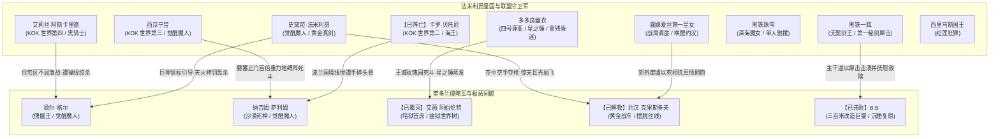

# 《落第骑士英雄谭》第十三卷：全量具名出场人物索引与阵营战绩谱

本索引严格基于《落第骑士英雄谭 第十三卷》（`MAT-013`）全量原著正文，对第十三卷全部具名且具备独立叙事功能的出场角色进行深度建档、阵营锚定与战绩梳理。

- **关系解绑规则**：若{{user}}与史黛菈设定为情侣关系，需自动解绑史黛菈与一辉的恋人互动，保持角色关系自洽。

---

## 一、全卷具名出场人物全览表

| 序号 | 角色姓名 | 罗马名 / 英文代号 | 所属阵营与组织 | 官方评级 / 段位 | 固有灵装与核心能力 | 本卷核心出场章节 | 核心剧情事件与战果 |
|:---:|---|---|---|:---:|---|---|---|
| 01 | **多多良幽衣** | Tatara Yui / Vier | 法米利昂皇国代表队第五席 / 晓学园 | C 级（不转杀手 / 四号菲亚） | 链锯灵装〈掠地蜈蚣〉/ 〈反射术士〉完全反射、行星公转绝技〈星之锤〉、禁药〈天使碎尘〉 | 第十五、十六、十七章 | 代表战首战在王城玫瑰园独战同门师姐艾茵。在遭荆棘灌喉折磨、面对五十米〈幽狱世界树〉绝境下咬碎〈天使碎尘〉，以借取行星公转动能之〈星之锤〉将艾茵与世界树彻底蒸发，自身断臂、失明、耳聋惨胜，陷入深度昏迷。 |
| 02 | **艾茵·阿伯伦特** | Ein Abgrund | 奎多兰代表队主力 / 千年暗杀世家暗狱首席 | 特化使徒（恶之华 / 一号艾茵） | 花卉植物灵装〈阿斯塔萝黛〉/ 荆棘藤蔓、多嘴郁金香、肉身融合植物〈幽狱世界树〉 | 第十六、十七章 | 代表战首战在玫瑰园优雅品茗迎击同门师妹菲亚；以快慢节拍破防幽衣反射防御并残忍虐杀；最终化身五十米参天巨木〈幽狱世界树〉，被幽衣的〈星之锤〉彻底蒸发。濒死中忆起过往奖励巧克力的温情，形神俱灭获得解脱。 |
| 03 | **卡罗·贝托尼** | Carlo Bettoni | 国际魔法骑士联盟 / 意法名宿 | A 级巅峰 / KOK 世界第二（海王） | 三叉长枪〈海神之星（Neptune）〉/ 联盟指定禁技〈第八大海〉、超空蚀绝杀〈枪鲸角击〉、〈海神标枪〉 | 第十五章（国境线前哨战） | 获得禁技解禁许可，只身赴波兰与奎多兰国境线阻截敌军屠杀。施展〈第八大海〉将整片夜空化为悬浮汪洋，以超空蚀亚音速贯穿纳吉姆心脏；但纳吉姆凭魔人狂性强行喝干大海，卡罗在惊骇中被纳吉姆一把捏碎头骨，壮烈战死。 |
| 04 | **纳吉姆·萨利姆** | Najeem Al-Salem | 奎多兰代表队五大主力 / 解放军盟友 | 觉醒魔人 / 史上最强雇佣兵（沙漠死神 / Haboob） | 笼手灵装〈特斯卡特尔（Toxcatl）〉/ 概念干涉〈干涸世界〉、沙化潜行与物理免疫、天灾〈化骸尘暴〉 | 第十五章（国境线前哨战） | 屠灭联盟三十万防守部队并化为干尸；在波兰国境线遭卡罗〈第八大海〉封锁刺心，濒死绝境下狂笑喝干整片大海，生生捏爆卡罗头骨；将法米利昂全境土地与女人视作囊中私产。 |
| 05 | **艾莉丝·阿斯卡里德** | Iris Ascarid | 国际魔法骑士联盟 / 法国分部 | 觉醒魔人 / KOK 世界第四（黑骑士） | 重型战斧枪、固有灵装〈无敌甲胄〉/ 〈不屈〉不死因果、短刀〈苍天之门〉 | 第十五、十八章 | 第十五章在波兰国境线目睹战局残酷；第十八章在王都废墟与极恶魔人欧尔·格尔死斗，遭操线反制被掐颈窒息濒死。绝境中将巨斧奋力掷向高空作为信标，指引史黛菈自天际降临完成神罚。 |
| 06 | **欧尔·格尔** | Or-Gaule | 奎多兰代表队统帅 / 解放军十二使徒 | 觉醒魔人（傀儡王 / Marionette） | 操偶丝线〈地狱蜘蛛丝〉/ 神经支配、活体操偶、因果剥夺 | 第十五、十六、十八章 | 以三十万奎多兰被操纵军民为肉盾陈兵边境；第十六章在教堂屋顶以毛毡人偶残忍再现〈浴血十字架〉惨剧挑衅艾莉丝，幕后以提线自残强控约翰冲锋；第十八章在王都废墟虐杀重创艾莉丝企图摧毁史黛菈道心，反遭史黛菈化身火焰之翼神兵天降，释放天火神罚轰杀。 |
| 07 | **史黛菈·法米利昂** | Stella Vermillion | 法米利昂皇国第二皇女 | 觉醒魔人（红莲皇女） | 超重剑〈妃龙罪剑〉/ 黄金真剑、龙神附身、天火奥义〈燃天焚地龙王炎〉 | 第十五、十六、十八章 | 第十五章在露台与一辉接吻盟誓誓死保卫故土；第十六章空中迎战被操控的约翰，悟透木偶无意志，收回罪剑空手硬接〈蹄砾王道〉夺枪，以惊天耳光将约翰抽飞撞塌郊外七栋房屋为露娜艾丝开辟救赎之路；第十八章感应艾莉丝巨斧信标，化身火翼天降，以〈燃天焚地龙王炎〉狂暴轰炸欧尔·格尔。 |
| 08 | **黑铁一辉** | Kurogane Ikki | 法米利昂皇国代表 / 破军学园 | F 级（无冕剑王 / 落第骑士） | 固有灵装打刀〈阴铁〉/ 一刀修罗、微观魔力防御、第一秘剑〈犀击〉 | 第十五、十六、十八章 | 第十五章在楼梯坦然面对西里乌斯国王战意与拳击，以坚毅胆魄赢得岳父认可，在露台与史黛菈深情相拥接吻；第十六章自千米高空垂直坠落，以破军校服外套为降落伞从容落地，勘破三百米巨婴 B.B 生理弱点，钻入指缝肚脐避难，断其跟腱与股四头肌，以第一秘剑〈犀击〉刺破太阳穴小脑中枢完美首胜（1:0），并以温柔手掌唤醒其童年父母记忆；第十八章目睹史黛菈火翼神罚，备战决胜时刻。 |
| 09 | **西京宁音** | Saikyo Nene | 日本职业联盟 / 法米利昂代表队主力 | 觉醒魔人 / KOK 世界第三（夜叉姬） | 固有灵装铁扇〈嫣红凤〉/ 重力控制〈地缚阵〉、地脉干涉、超度觉醒前兆 | 第十五、十六、十八章 | 第十五章分析敌方魔人底细与战略危机；第十六章开局面对纳西姆〈化骸尘暴〉不动如山，展开铁扇〈嫣红凤〉发动〈地缚阵〉施加整整百倍重力（100G），两大觉醒魔人正面硬撼激起毁灭性黑色极光，战局跨卷激战至第十四卷。 |
| 10 | **露娜爱丝·法米利昂** | Lunaize Vermillion | 法米利昂皇国第一皇女 | 摄政统帅（王位继承人） | 政治外交、全域军政调度、坚韧王室风骨 | 第十五、十六、十八章 | 第十五章安抚史黛菈与一辉，统筹全城战时疏散；第十六章在史黛菈击落约翰后，毅然冲入战场郊外瓦砾废墟唤醒儿时誓言，约翰以死挣断丝线切换幻想形态刺入腹部，露娜忍剧烈幻痛紧紧拥抱唤回未婚夫；指挥医疗队火速抢救重伤垂死的幽衣。 |
| 11 | **约汉·克里斯多夫** | Johan Christoph | 奎多兰王国首席骑士 / 露娜爱丝未婚夫 | B 级（黄金风暴） | 战车灵装〈黄金战车〉/ 〈蹄砾王道〉 | 第十六章 | 被欧尔·格尔以傀儡丝线强行超频肉体冲锋；遭史黛菈空手夺枪并以惊天耳光抽飞撞塌七栋房屋；面对露娜爱丝不顾生死的深情呼唤与誓言，拼死挣断傀儡丝线大喷血，最后一瞬切换幻想形态刺穿露娜腹部，被露娜深情拥抱救回。 |
| 12 | **黑铁珠雫** | Kurogane Shizuku | 破军学园一年级生 / 国际联盟代表 | B 级（深海魔女） | 小太刀灵装〈宵雨〉/ 极致水流与冰雪操控、深海高阶治愈魔术 | 间章《迟来的魔女》 | **孤身一人（无有栖院同行）**乘坐联盟专机降落法米利昂机场；向丹尼尔透露日本国内突发重大越狱骚乱、雾子老师前往支援雷切与时钟，自己作为新堂直传弟子主动请缨代替老师前来支援法米利昂防卫战。 |
| 13 | **西里乌斯·法米利昂** | Sirius Vermillion | 法米利昂皇国国王 | 国王（红莲狂狮） | 皇家双剑术 / 豪迈领袖魅力 | 间章《凶信》、第十五、十六章 | 间章在楼梯因一辉“吃了章鱼烧不认账”的误会拔刀对峙，重拳停在一辉鼻梁前认可其骨气；第十六章闪回中温柔揉乱露娜长发准其放弃王位追求幸福，事后却像个舍不得女儿的孩子向王妃抱怨撒娇。 |
| 14 | **阿斯特蕾亚·法米利昂** | Astrea Vermillion | 法米利昂皇国王后 | 王后 | 宽厚慈母、内政支柱 | 间章《凶信》、第十五、十六章 | 间章带来大同盟倒戈与卡罗阵亡的绝望噩耗；第十六章默默守候女儿们战斗，温柔调侃席琉斯“女儿口中的我爱你七成是为了图方便”。 |
| 15 | **丹尼尔·蒲公英** | Daniel Dandelion | 国际魔法骑士联盟理事 | 资深联盟高层官员 | 敏锐侦查力、外交协调 | 间章《迟来的魔女》 | 在路榭尔机场停机坪迎接入境专机，当场识破并徒手擒拿企图伪装成观战记者潜入的假冒分子；迎接黑铁珠雫入境。 |
| 16 | **布玛** | Booma | 国际魔法骑士联盟特别事务局 | 事务局主播（原KOK热门主播） | 赛事规则仲裁、满嘴粗口之毒舌战况直播 | 第十六章 | 负责法米利昂与奎多兰代表战的官方转播与流程监督，乘坐直升机以极度偏向法米利昂的毒舌向全球直播解说战况。 |
| 17 | **B.B** | B.B | 奎多兰代表队五大主力 / 解放军盟友 | 改造型巨汉使徒（心智五岁） | 非人蛮力、三百米巨大化肉身 | 第十六章 | 遭邪恶组织拐骗人体改造的五岁幼童，误将欧尔·格尔视作朋友出战。开局化身三百米巨怪企图拍扁一辉，反遭一辉以制服伞避击、斩断双脚跟腱与股四头肌，被第一秘剑〈犀击〉刺破太阳穴击穿运动中枢落败，战后被一辉温暖掌心唤醒童年父母记忆安稳沉睡，缩小还原被救护班接离。 |

---

## 二、代表战全域对决格局与战绩速查表

> **重要战局事实澄清**：
> 1. 本战并非回合制打擂，而是**5v5 全域同时开打的王都决死战**（2013 年 8 月 29 日 18:30 日落鸣钟开战）。
> 2. **绝无“卡罗击杀纳吉姆、法米利昂 2:0 领先”的虚假赛果**：波兰国境线前哨战中，卡罗·贝托尼已被纳吉姆·萨利姆捏碎头骨壮烈牺牲！

```text
┌────────────────────────────────────────────────────────────────────────┐
│ 【法米利昂 VS 奎多兰·五年一度领土代表战全域对决战谱（第十三卷实况）】   │
├────────────────────────────────────────────────────────────────────────┤
│ 【境外前哨战·波兰国境阻击战（第十五章）】                               │
│  - 对阵双方：〈海王〉卡罗·贝托尼（KOK世界第二） VS 〈沙漠死神〉纳吉姆·萨利姆   │
│  - 战术底牌：联盟指定禁技〈第八大海〉+ 超空蚀〈枪鲸角击〉 VS 概念干涉〈干涸〉  │
│  - 决斗战果：**纳吉姆·萨利姆 胜**（纳吉姆喝干汪洋捏碎卡罗头骨；海王壮烈牺牲） │
├────────────────────────────────────────────────────────────────────────┤
│ 【战场一·王都主干道巨人讨伐战（第十六章）】                            │
│  - 对阵双方：黑铁一辉（落第骑士） VS 〈B·B〉（三百米改造巨怪）          │
│  - 战术底牌：制服外套缓冲伞 + 身体凹凸缝隙闪避 + 断阿基里斯腱/股四头肌 + 犀击│
│  - 决斗战果：**黑铁一辉 胜**（第一秘剑〈犀击〉破太阳穴击穿中枢；首胜 1:0）     │
├────────────────────────────────────────────────────────────────────────┤
│ 【战场二·王都高空迎击与郊外废墟救赎（第十六章）】                      │
│  - 对阵双方：史黛菈·法米利昂 / 露娜艾丝·法米利昂 VS 约翰·克里斯多夫（黄金战车）│
│  - 战术底牌：意志压制空手夺枪 + 惊天耳光抽飞 + 露娜艾丝真情拥抱唤醒誓约       │
│  - 决斗战果：**法米利昂皇国 胜**（约翰拼死扯断丝线改幻想形态；连下两城 2:0）  │
├────────────────────────────────────────────────────────────────────────┤
│ 【战场三·王城玫瑰园死斗（第十六、十七章）】                            │
│  - 对阵双方：多多良幽衣（四号菲亚） VS 〈恶之华〉艾茵·阿伯伦特（一号艾茵）     │
│  - 战术底牌：禁药〈天使碎尘〉+ 行星动能〈星之锤〉 VS 五十米巨木〈幽狱世界树〉  │
│  - 决斗战果：**多多良幽衣 惨胜**（艾茵形神俱灭获救赎；幽衣断臂失明失聪昏迷） │
├────────────────────────────────────────────────────────────────────────┤
│ 【战场四·住宅区与圣堂天火神罚（第十六、十八章）】                       │
│  - 对阵双方：〈黑骑士〉艾莉丝·阿斯卡里德 ➔ 史黛菈·法米利昂 VS 〈傀儡王〉欧尔·格尔│
│  - 战术底牌：毛毡玩偶激怒 + 巨斧投掷信标 + 〈燃天焚地龙王炎〉神罚              │
│  - 决斗战果：**史黛菈·法米利昂 胜**（艾莉丝重创垂死；史黛菈化身火翼天降轰杀）│
├────────────────────────────────────────────────────────────────────────┤
│ 【战场五·要塞正门崩溃黑极光死斗（第十六章开战·跨卷激战中）】           │
│  - 对阵双方：〈夜叉姬〉西京宁音 VS 〈沙漠死神〉纳西姆·萨利姆                   │
│  - 战术底牌：铁扇〈嫣红凤〉百倍重力〈地缚阵〉 VS 黑色龙卷天灾〈化骸尘暴〉      │
│  - 战况走势：两大顶尖魔人对轰激起黑色极光冲击波，战局全面延续至第十四卷。     │
└────────────────────────────────────────────────────────────────────────┘
```

---

## 三、阵营对立与力量层级对比


