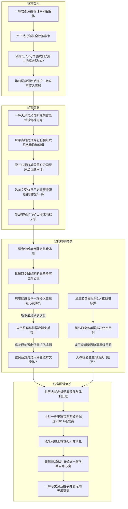

# 《落第骑士英雄谭》第十九卷：卷内时间线与关键事件锚点

## 1. 时间轴设计说明

本时间线针对《落第骑士英雄谭 第十九卷》（材料标识：`MAT-019`）进行高精度终章事件锚定。第十九卷剧情主要跨越**营救决战的致命48小时**（矿山突入、心灵斩击、大教授覆灭），以及大战平息数月后的**法米利昂王城世纪大婚典礼**。

---

## 2. 卷内时间轴事件清单（T01–T08）

| 节点编号 | 剧情时间 / 相对时间 | 涉及章节与行号 | 对应场景条目 | 发生地点 | 核心参与人物 | 核心事件与因果逻辑 |
|---|---|---|---|---|---|---|
| **T01** | 史黛菈被掠后首日·深夜至凌晨 | 间章 `L1–L182` | [`01_间章场景_遭囚的皇女.md`](file:///e:/web/落第/第十九卷-世界书整理/场景条目/01_间章场景_遭囚的皇女.md) | 栃木县日光市废弃矿山地下两百公尺要塞 | 卡尔·爱兰兹（大教授）、史黛菈·法米利昂、亚伯拉罕 | **遭囚的母体与基因抽取**。史黛菈被剥光囚禁于密闭营养容器中，大教授以神经药剂与低氧抑制其超速抗药性；揭示暴君噬血者生殖细胞转世与魔人母体计划；下令亚伯拉罕佩戴灵装〈福音〉启动〈精神操控〉，5小时剥离“红莲皇女”人格倒计时启动。 |
| **T02** | 突袭动员与第一层洗脑恶梦·清晨 | 第四章 `L183–L850` | [`02_第四章场景_划破黑暗.md`](file:///e:/web/落第/第十九卷-世界书整理/场景条目/02_第四章场景_划破黑暗.md) | 破军学园主校舍保健室 / 史黛菈精神梦境 | 黑铁一辉、黑铁珠雫、黑铁严、黑铁王马、东堂刀华、有栖院凪、史黛菈 | **保健室杀气对峙、木偶剧场火灾恶梦与突袭部署**。一辉因战损体细胞呈幼童体态苏醒，闻噩耗欲狂奔救妻遭严与王马拦截；一辉珠雫拔刀相向爆发冷冽杀气；严正式下达分部长搜救令全权承担后果，指派王马、刀华随行，有栖院凪钻入一辉影子潜行；同刻培养槽内的史黛菈陷入第一层洗脑恶梦（童年木偶剧场火焰失控烧死挚友特尔米特与米莉亚莉亚、遗忘一辉名字与面孔，洗脑深度达70%）。 |
| **T03** | 矿山强攻、风雷断后与巨婴降诞·上午 | 第四章 `L851–L2065` | [`02_第四章场景_划破黑暗.md`](file:///e:/web/落第/第十九卷-世界书整理/场景条目/02_第四章场景_划破黑暗.md) | 日光废矿地表 $\to$ 地下一至五层 | 黑铁一辉、黑铁珠雫、王马、刀华、有栖院凪、大型EDY、亚伯拉罕、爱兰兹 | **兄妹合体强攻、第四层风雷断后与第五层初战**。珠雫以〈水色世界〉与一辉细胞融合（自身缩小立于兄长肩头）助一辉恢复少年体态；击溃三百叛乱军残党与三具大型 EDY；有栖院放影鼠摸清五层地形；第四层遭五具亚伯拉罕伏击，刀华引高压电缆化〈雷神〉腰斩一人，王马以〈断月天龙爪·真打〉掩护一辉珠雫破门直入第五层；第五层识破一氧化碳陷阱后，一辉以第六秘剑〈毒蛾太刀〉重创爱兰兹，爱兰兹将二十余具克隆体化作两层楼高的〈达尔文〉巨婴怪兽，宣告距洗脑完成仅剩30分钟！ |
| **T04** | 最深层血战与大爆炸·上午至午后 | 第五章 `L2066–L4060` | [`03_第五章场景_大教授.md`](file:///e:/web/落第/第十九卷-世界书整理/场景条目/03_第五章场景_大教授.md) | 日光废矿地下五层核心实验室 | 黑铁一辉、珠雫、爱兰兹（剑神完成体傀儡）、史黛菈（被操控）、王马、刀华 | **傀儡肉身覆灭、爱人背刺与暴龙咆吼**。一辉以断冰与水分身神经毒斩断达尔文巨婴；爱兰兹化身一辉全盛期剑神完成体以完全结实压制；一辉以复合秘剑〈天津电光〉与断绳第五十八刀削首；随后一刀罗刹诱敌，珠雫破除合体以灵装〈宵时雨〉贯穿爱兰兹心脏引爆〈胭红六花·散华〉炸碎肉身；史黛菈苏醒言辞现时间差破绽，持妃龙罪剑背刺贯穿一辉胸膛，揭晓爱兰兹真正本体为美国黄石公园房屋级巨脑，操控史黛菈释放〈暴龙咆吼〉将整座矿山炸成深坑焦土火海！ |
| **T05** | 心灵世界破茧·午后约16:00–17:00 | 第六章 `L4061–L5850` | [`04_第六章场景_最爱也是最强的劲敌.md`](file:///e:/web/落第/第十九卷-世界书整理/场景条目/04_第六章场景_最爱也是最强的劲敌.md) | 矿山焦土大坑 / 史黛菈心灵精神空间 | 黑铁一辉、史黛菈、爱兰兹（意识）、爱德怀斯、王马、珠雫 | **比翼斩角、女武神神威与憧憬的追影**。一辉焦土苏醒为救同伴陷入超度觉醒鬼化万象皆追影；爱德怀斯降临双剑斩断骨角唤醒一辉；王马焦黑重创怒斥；珠雫以最后魔力促成合体潜入识海；爱德怀斯以斩律断理繁星剑三十米女武神神威压制燃天焚地龙王炎争取一分钟；一辉侵入史黛菈七十年枯槁老妇牢笼，看破其紧抱妃龙罪剑的不甘执念，不吐片语斩下最终秘剑〈追影〉！史黛菈返老还童振飞追影相拥，现实中龙炎焚尽耳孔爬出的人面达尔文变形虫！ |
| **T06** | 异国越洋斩首·同一时刻（约17:00–17:30） | 第六章 `L5851–L6373` | [`04_第六章场景_最爱也是最强的劲敌.md`](file:///e:/web/落第/第十九卷-世界书整理/场景条目/04_第六章场景_最爱也是最强的劲敌.md) | 美国怀俄明州黄石国家公园地下巨型空洞 | 福小莉（饕餮）、卡尔·爱兰兹（巨脑本体） | **巨脑容器粉碎与大教授灭亡**。爱兰兹巨脑企图启动 114 枚战略核弹毁灭日法两国，福小莉受爱德怀斯与白胡公托付神速突入，以〈五兵大主·燃天焚地龙王炎〉烈焰崩拳轰穿特制玻璃煮烂脑髓，随后第二拳深入脑髓烧成焦炭飞灰，核危机解除，大教授彻底陨落；月影总理苏醒与黑铁严立誓终结放纵必要之恶的旧制度。 |
| **T07** | 战后余韵与晋升·十月初 | 终章 `L6374–L6850` | [`05_终章场景_背负憧憬的意义.md`](file:///e:/web/落第/第十九卷-世界书整理/场景条目/05_终章场景_背负憧憬的意义.md) | 破军学园训练场与宿舍 | 黑铁一辉、日下部加加美 | **劲敌新程与 KOK 破格晋升**。破军学园因战后休整暑假延长一个月；一辉身体经珠雫两周调理完全康复，清晨训练并驻足第三训练场追溯全轨迹；加加美采访披露一辉与史黛菈因显赫战功获三国推荐直接破格跳级保送下年度 KOK·A 级职业联赛；黑乃重返 A 级赛场引爆宁音闭关；诸星雄大受黑铁严举荐保送国防大学从政为将；刀华藏人领跑职业赛；天音抓捕逃狱犯赦免入巨门学园钻研因果剑术。 |
| **T08** | 全剧最高潮·十月周末婚礼日 | 终章 `L6851–L7030` | [`05_终章场景_背负憧憬的意义.md`](file:///e:/web/落第/第十九卷-世界书整理/场景条目/05_终章场景_背负憧憬的意义.md) | 法米利昂皇国王城大圣堂 / 机坪大道 | 黑铁一辉、史黛菈、席琉斯、阿斯特蕾亚、莎拉、菲亚等 | **落第骑士终局大婚与心魔告别**。一辉乘皇室专机抵法米利昂，机坪迎接身披珍珠纯白婚纱、美若天仙的史黛菈；一辉下意识流露自惭形秽的自卑自嘲，史黛菈温柔撞入怀中严厉斥责其否定自我之过；一辉彻底告别自残式负面动力，斩断“落第骑士”心魔枷锁，两人十指紧扣，阔步奔向无垠蓝天，全作至高无憾完结！ |

---

## 3. 终局战役因果图

