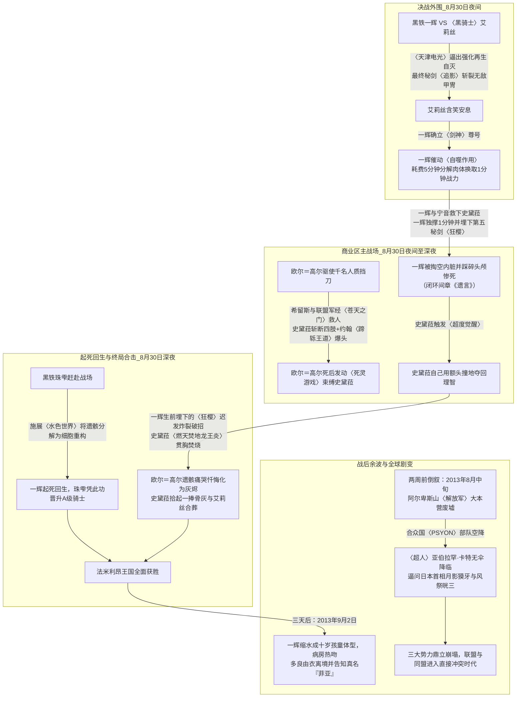

# 《落第骑士英雄谭》第十五卷：卷内时间线与关键事件锚点

## 1. 时间轴设计说明

本时间线针对《落第骑士英雄谭 第十五卷》（材料标识：`MAT-015`）进行高精度事件锚定，并与前序第十四卷的绝对日历基准（**西历 2013 年 8 月 30 日**）无缝衔接：
- **决战主轴（T01–T07）**：全部发生于 **西历 2013 年 8 月 30 日（星期五）夜间至深夜**（法米利昂战争决战夜的最后阶段，其中卷首《间章 遗言》为 T04 一辉战死瞬间的倒叙切片）；
- **战后日常（T08）**：发生于 **西历 2013 年 9 月 2 日（星期一）白天**（第二十五章 L160 显式标注「战争结束之后才过三天」）；
- **终章倒叙（T09）**：发生于 **西历 2013 年 8 月中旬**（终章 L28 显式标注「双方的初次冲突，发生在法米利昂战役落幕的两周以前」）。

---

## 2. 卷内时间轴事件清单（T01–T09）

| 节点编号 | 绝对时间 / 相对时间 | 涉及章节与行号 | 发生地点 | 核心参与人物 | 核心事件与因果逻辑 |
|---|---|---|---|---|---|
| **T01** | **2013年8月30日（周五）夜间** | 第二十二章 `L48–L1815` （分章 `L1–L1768`） | 法米利昂旧都·住宅区空地 | 黑铁一辉、艾莉丝·阿斯卡里德、欧尔＝高尔（观战） | **〈落第骑士〉VS〈黑骑士〉决死战**。一辉看穿〈黑寡妇〉单分子丝缝隙，以第七秘剑〈电光〉融合黑铁王马百八连击〈天津风〉的**〈天津电光〉**猛攻，逼得艾莉丝过度催动〈强化再生〉引发肉体自灭；最终一辉在〈一刀罗刹〉下使出凝聚魔人〈引力〉概念的**最终秘剑〈追影〉**斩开〈无敌甲冑〉。艾莉丝向一辉道谢后含笑逝世。 |
| **T02** | **2013年8月30日（周五）夜间** （决斗结束即刻） | 第二十二章 `L1816–L1978` （分章 `L1769–L1931`） | 住宅区战场·艾莉丝遗体旁 | 黑铁一辉、联盟医疗班 | **〈剑神〉尊号确立与〈自噬作用〉启动**。一辉擦拭艾莉丝遗容，此战令一辉正式获得伴随大半生的尊号**〈剑神〉**。为救援史黛菈，体力耗尽的一辉主动诱发细胞**〈自噬作用（Autophagy）〉**，耗费5分钟分解自身肌肉组织以换取1分钟的极限战斗能量。 |
| **T03** | **2013年8月30日（周五）夜间** （艾莉丝阵亡广播后） | 第二十三章 `L1979–L2609` （分章 `L1–L631`） | 旧都商业区废墟及上空 | 史黛菈、欧尔＝高尔、希留斯、堤米特、米利雅莉亚、席格娜、约翰、露娜爱丝、布马 | **千名人质解救、〈蹄轹王道〉爆头与〈死灵游戏〉开演**。欧尔＝高尔驱使千名奎德兰人质挡刀并斩断布马的直播直升机；希留斯率亲卫队与联盟军经战前预设的〈苍天之门〉进场解救人质；史黛菈斩断欧尔＝高尔四肢并将其抛向夜空，约翰与露娜爱丝跃出〈苍天之门〉以**〈蹄轹王道〉**轰碎其头颅。然而欧尔＝高尔死后发动**〈死灵游戏（Danse Macabre）〉**，无头残躯重起并用灵力蛛丝将史黛菈死死束缚。 |
| **T04** | **2013年8月30日（周五）深夜** （对应间章《遗言》） | 间章 `L3–L47`； 第二十四章 `L2610–L3736` （分章 `L1–L1127`） | 商业区废墟主战场 | 欧尔＝高尔、史黛菈、黑铁一辉、西京宁音、华伦斯坦（回忆） | **『浴血十字架』、一分钟死斗与一辉惨烈战死**。欧尔＝高尔残躯上演人偶剧揭露十五年前大脑萎缩两成及桥下被〈独腕剑圣〉华伦斯坦捏断肋骨逼迫屠村的过去；一辉以〈犀击〉突入、西京宁音扭曲空间护住市民，一辉斩断尸骸右手救下史黛菈并独撑一分钟（期间悄然埋下第五秘剑〈狂樱〉）。力竭瞬间一辉被欧尔＝高尔刺穿胸膛扯出内脏，留下遗言「史黛菈，我爱你。」后战死（闭环间章《遗言》）。 |
| **T05** | **2013年8月30日（周五）深夜** （一辉战死后数秒） | 第二十四章 `L3737–L4102` （分章 `L1128–L1493`） | 商业区战场血泊中央 | 史黛菈、欧尔＝高尔、西京宁音、黑铁珠雫 | **踩碎头颅、〈超度觉醒〉与撞地重夺理智**。欧尔＝高尔踩烂一辉内脏并当着史黛菈的面踩碎一辉头颅；史黛菈理智崩断触发龙人化的**〈超度觉醒〉**（双角、骨翼、长尾、黑鳞），但凭自身意志不断用额头猛撞地面冷却魔力，痛哭怒骂一辉后主动夺回理智；〈深海魔女〉黑铁珠雫赶抵现场。 |
| **T06** | **2013年8月30日（周五）深夜** （决战最后数分钟） | 第二十四章 `L4103–L4392` （分章 `L1494–L1783`） | 商业区战场血泊中央 | 黑铁珠雫、史黛菈、西京宁音 | **〈水色世界〉分解细胞重构肉体**。珠雫将在药师桐子门下苦修的医术与自身能力结合，展开蓝色天使光翼发动**〈水色世界〉**，将一辉破碎散落的遗骸分解为细胞粒子再重新构筑肉体；宁音起誓接下史黛菈全力一击的余波。 |
| **T07** | **2013年8月30日（周五）深夜** （决战终局一瞬） | 第二十四章 `L4393–L4892` （分章 `L1784–L2283`） | 商业区地面至高空 | 史黛菈、欧尔＝高尔、黑铁一辉（狂樱迟发）、丹达利昂、希留斯 | **第五秘剑〈狂樱〉破招、〈燃天焚地龙王炎〉与遗骸洒泪**。丹达利昂与希留斯率全军筑起五层人墙护卫珠雫；欧尔＝高尔扯断右臂将史黛菈击飞至高空并发动最强绝技**〈杀戮戏曲〉**，史黛菈携**〈燃天焚地龙王炎〉**俯冲；碰撞瞬间一辉生前埋下的近十道**第五秘剑〈狂樱〉**同时炸裂瓦解〈杀戮戏曲〉！烈焰中欧尔＝高尔因史黛菈点破艾莉丝的亲情而放声痛哭忏悔并化为灰烬，史黛菈拾起一捧骨灰留作姐弟合葬，法米利昂战争正式获胜落幕。 |
| **T08** | **2013年9月2日（周一）白天** （战争结束三天后） | 第二十五章 `L4893–L6633` （分章 `L1–L1741`） | 王都病房 → 法米利昂国际机场 | 黑铁一辉、史黛菈、黑铁珠雫、西京宁音、希留斯、雅丝忒莉亚、丹达利昂、多良由衣（菲亚） | **十岁小一辉、珠雫晋升A级、病房深吻与「菲亚」送别**。一辉苏醒，珠雫解除细胞嫁接后一辉因缺失三成肉体缩水成**十岁孩童体型**（需半年恢复）；宁音宣布珠雫晋升**A级骑士**，并转达法国支部长〈刺刃〉雷薇将姐弟合葬及「无条件协助一辉一次」的口信；珠雫训斥一辉后，史黛菈锁门算账并与小一辉深吻（被国王夫妇破门撞见）；史黛菈赴机场炸机挽留多良由衣，由衣用轮椅撞击史黛菈胫骨捍卫恶党自我（Ego），临别掷出杀手名片承诺出席婚礼并发短信告知真名**「菲亚（Fia）」**。 |
| **T09** | **2013年8月中旬** （战役落幕两周前·倒叙） | 终章 `L6634–L6718` （分章 `L1–L85`） | 阿尔卑斯山脉·〈解放军〉大本营废墟 | 亚伯拉罕·卡特、风祭晄三、月影獏牙、风祭凛奈、夏洛特·科黛、莎拉·布拉德莉莉 | **合众国〈PSYON〉空降与〈超人〉亚伯拉罕·卡特质问**。三大势力鼎立格局因〈解放军〉大本营覆灭而瓦解；美利坚合众国最强超能力部队〈PSYON〉三架武装直升机降临阿尔卑斯山废墟，风祭晄三制止凛奈三女出手；队长**〈超人（The hero）〉亚伯拉罕·卡特**不带降落伞从天而降，以代表「世界正义（States）」的机械口吻逼问日本首相月影獏牙与风祭晄三的阵营归属。 |

---

## 3. 战场因果链路与战术复盘

