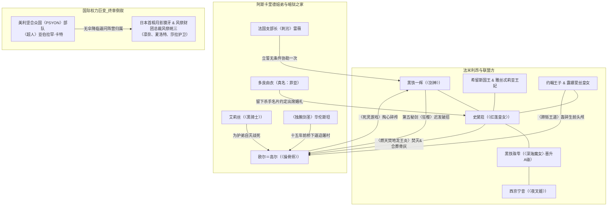

# 《落第骑士英雄谭》第十五卷：出场人物全量索引与阵营图谱

## 1. 阵营分布总览

第十五卷登场人物横跨五大主要势力：
1. **法米利昂王国与国际魔法骑士联盟支援方**：黑铁一辉、史黛菈·法米利昂、黑铁珠雫、西京宁音、希留斯·法米利昂、雅丝忒莉亚·法米利昂、露娜爱丝·法米利昂、席格娜、丹尼尔·丹达利昂、堤米特、米利雅莉亚、雷薇·阿斯卡里德（口信提及）、布马（随军记者）；
2. **奎德兰王国与〈第一王子〉阵营**：欧尔＝高尔（本名欧尔雷斯·格尔）、艾莉丝·阿斯卡里德（〈黑骑士〉）、约翰·克里斯托夫·冯·科尔布兰德（奎德兰第二王子，正统复辟方）；
3. **〈暗狱之家（Abgrund）〉（第三方协战者）**：多良由衣（真名：菲亚 / Fia）；
4. **〈解放军〉残党与日本政商首脑**：风祭晄三、风祭凛奈、夏洛特·科黛、莎拉·布拉德莉莉、华伦斯坦（欧尔＝高尔回忆出场）、月影獏牙（日本首相）；
5. **〈大国同盟（Union）〉/ 美利坚合众国〈PSYON〉部队**：亚伯拉罕·卡特（〈超人 / The hero〉）。

---

## 2. 核心具名人物详细索引表

| 人物姓名 | 称号 / 别名 | 所属阵营 | 灵装 / 战力机制 | 卷内关键战绩与出场情节 | 终局状态 |
|---|---|---|---|---|---|
| **黑铁一辉** | 〈落第骑士〉 〈无冕剑王〉 〈七星剑王〉 **〈剑神〉** | 破军学园 / 法米利昂军外援 | 〈阴铁〉 第七秘剑〈电光〉→〈天津电光〉 最终秘剑〈追影〉 第五秘剑〈狂樱〉 〈自噬作用〉 | 第22章以〈天津电光〉逼出艾莉丝自灭，并以凝聚魔人〈引力〉的最终秘剑〈追影〉斩开〈无敌甲冑〉，确立**〈剑神〉**尊号；催动〈自噬作用〉赶赴主战场，第24章独撑一分钟并埋下第五秘剑〈狂樱〉后被掏空内脏、踩碎头颅战死（对应间章《遗言》）；经珠雫〈水色世界〉复活并通过〈狂樱〉迟发炸裂助史黛菈破除〈杀戮戏曲〉；第25章解除细胞嫁接后缩水成十岁孩童体型（需半年恢复）。 | **存活**（复活后暂缩水为十岁体型） |
| **史黛菈·法米利昂** | 〈红莲皇女〉 | 法米利昂王国第二皇女 | 〈妃龙罪剑〉 〈龙神附身〉 〈超度觉醒〉 〈燃天焚地龙王炎〉 | 第23章借〈苍天之门〉破除人质盾牌、斩断欧尔＝高尔四肢并配合约翰处决，后为救约翰与露娜爱丝被〈死灵游戏〉束缚；第24章目睹一辉被踩碎头颅触发龙人化〈超度觉醒〉，凭自身意志撞地恢复理智，与一辉的〈狂樱〉联手以〈燃天焚地龙王炎〉烧尽欧尔＝高尔并拾起骨灰留作姐弟合葬；第25章病房锁门与小一辉热吻，赴机场送别菲亚。 | **存活**（内定下任法米利昂女王） |
| **艾莉丝·阿斯卡里德** | 〈黑骑士〉 | 国际魔法骑士联盟法国支部（为护弟倒戈） | 〈黑寡妇〉 〈无敌甲冑〉 〈大蜘蛛巢城〉 〈强化再生〉 | 第22章为兑现亡母遗言保护弟弟欧尔＝高尔，将自身神经化为丝线使〈黑寡妇〉强化五倍；面对一辉的〈天津电光〉过度使用〈强化再生〉引发海佛烈克极限自灭，被最终秘剑〈追影〉斩破甲冑后在一辉怀中含笑逝世；战前还奉联盟命令预设了〈苍天之门〉。 | **战死**（遗体运回法国故乡与弟合葬） |
| **欧尔＝高尔** （欧尔雷斯·格尔） | 〈第一王子〉 〈操骨师〉 | 〈解放军〉叛徒 / 奎德兰篡位者 | 〈提线人偶〉 〈死灵游戏〉 〈杀人戏曲〉 〈杀戮戏曲〉 | 第23章驱使千名人质挡刀并斩断直播直升机，被史黛菈斩断四肢并被约翰〈蹄轹王道〉轰碎头颅后发动死后绝技〈死灵游戏〉；第24章上演『浴血十字架』揭露十五年前被华伦斯坦逼迫屠村的过去，掏心碎颅杀死一辉，最终被一辉生前埋下的〈狂樱〉与史黛菈〈燃天焚地龙王炎〉击溃，因艾莉丝的亲情放声痛哭忏悔后化为灰烬。 | **彻底败亡**（一捧骨灰与姐合葬） |
| **黑铁珠雫** | 〈深海魔女（Lorelei）〉 | 破军学园 / 联盟医疗部队 | 〈宵时雨〉 〈水色轮回〉 **〈水色世界〉** | 第24章赶抵战场，将在药师桐子门下苦修的医术与自身能力结合发动〈水色世界〉，展开蓝色光翼将一辉破碎遗骸分解为细胞粒子重构肉体；第25章解除细胞嫁接，因达成「死者苏生」伟业被联盟正式晋升为**A级骑士**，并冷脸训斥一辉不珍惜生命的行为。 | **存活**（晋升A级骑士） |
| **西京宁音** | 〈夜叉姬〉 | 破军学园兼任教师 / 联盟A级骑士 | 〈地母神（花柳流扇）〉 重力与空间扭曲 | 击退〈沙漠死神〉后赶抵商业区（失去一条手臂），第24章展开空间领域偏转〈杀人戏曲〉护住全城国民，并接下史黛菈〈燃天焚地龙王炎〉的余波；第25章探病传达珠雫晋升A级与〈刺刃〉雷薇的口信，断臂可通过 KOK「细胞银行」恢复。 | **存活**（断臂待再生） |
| **多良由衣** （真名：**菲亚 / Fia**） | 〈无脸玩偶〉 | 〈暗狱之家（Abgrund）〉暗杀者 | 〈天使碎尘〉 | 失去半张脸、左手、半数消化器官及下半身，靠〈天使碎尘〉与珠雫脑部治疗生还；第25章在机场用电动轮椅脚踏板猛撞史黛菈胫骨，拒绝招安以捍卫恶党自我（Ego），临别甩出杀手名片承诺出席婚礼并发短信告知真名「菲亚」。 | **存活**（返回暗狱之家休养一年） |
| **约翰·克里斯托夫·冯·科尔布兰德** | 〈黄金风暴〉 | 奎德兰王国第二王子 | 黄金骑枪与骏马 〈蹄轹王道（Circus Maximus）〉 | 第23章在露娜爱丝同乘搀扶下策马跃出〈苍天之门〉，以〈蹄轹王道〉刺入欧尔＝高尔口中轰碎其头颅；在史黛菈宽慰下重振精神，战后与露娜爱丝共同安抚奎德兰国民并准备成婚。 | **存活** |
| **露娜爱丝·法米利昂** | 〈红蜂〉 | 法米利昂王国第一皇女 | 短剑灵装 | 第23章在马背上搀扶重伤的约翰完成〈蹄轹王道〉复仇一击；第25章提及她为嫁给约翰将放弃王位继承权。 | **存活** |
| **希留斯·法米利昂** | 法米利昂国王 | 法米利昂王室 | 火焰战斧 | 第23章率领身穿红法被的「皇室亲卫队」高喊应援口号拦下失控人质；第24章亲自挥斧挡下袭向珠雫的斩击；第25章破门撞见十岁小一辉与史黛菈热吻而暴走，被王妃拧住屁股制服。 | **存活** |
| **雅丝忒莉亚·法米利昂** | 法米利昂王妃 | 法米利昂王室 | — | 第25章与希留斯一同探病，拧住暴走丈夫的屁股，笑眯眯地调侃热吻的一辉与史黛菈，并告知多良由衣即将离境的消息。 | **存活** |
| **丹尼尔·丹达利昂** | 法米利昂支部长 | 国际魔法骑士联盟法米利昂支部 | 防御灵装 | 第24章指挥全体伐刀者组成五层圆形人墙并通过灵装共享魔力护卫珠雫；第25章在机场为多良由衣准备飞机送行。 | **存活** |
| **堤米特** | 〈白风〉 | 国际魔法骑士联盟骑士 | 〈星辰大海（Star Ocean）〉 | 第23章经〈苍天之门〉进场，发动〈星辰大海〉将商业区道路化为泥沼，成功迟滞被操纵的千名奎德兰人质。 | **存活** |
| **米利雅莉亚** | 〈天眼〉 | 法米利昂王国骑士 | 狙击步枪灵装 | 第23章运用黑铁一辉在卡尔迪亚传授的「行动波纹以指挥官为起点」观测法，找出人群中的「中继站」并用彩弹精准标记。 | **存活** |
| **席格娜** | 〈焦热〉 | 法米利昂王国骑士团长 | 火焰剑灵装 | 第23章率领部队迅速捆绑被米利雅莉亚标记的「中继站」国民，切断欧尔＝高尔的丝线控制。 | **存活** |
| **雷薇·阿斯卡里德** | 〈刺刃（Bayonet）〉 | 国际魔法骑士联盟法国支部长 | — | 艾莉丝与欧尔＝高尔的同族长辈；第25章通过宁音转达口信：已将姐弟合葬于法国故乡，并立誓未来无视任何道义与前提无条件协助黑铁一辉一次。 | **存活**（幕后提及） |
| **布马** | 随军记者 | 国际魔法骑士联盟报道班 | 转播麦克风 | 第23章在直升机上转播战况并怒斥欧尔＝高尔违反战争规则，直升机被斩成两截坠毁后大难不死，继续在地面残骸中播报法米利昂获胜。 | **存活** |
| **华伦斯坦** | 〈独腕剑圣〉 | 〈解放军〉最高干部 | 单手剑 | 第24章在欧尔＝高尔十五年前的回忆中出场：在河桥下仅凭步法与柔韧皮肤令丝线滑开，单手捏断欧尔＝高尔肋骨直至其失禁，一剑劈开石桥并下达一周内屠村加入〈解放军〉的通牒。 | **存活**（回忆出场） |
| **亚伯拉罕·卡特** | 〈超人（The hero）〉 | 美利坚合众国〈PSYON〉部队队长 | 合众国最强超能力（无伞缓降等） | 终章（战役落幕两周前倒叙）在阿尔卑斯山〈解放军〉大本营废墟不带降落伞从直升机跃下，以代表「世界正义（States）」的机械口吻逼问日本首相月影獏牙与风祭晄三的阵营立场。 | **存活** |
| **风祭晄三** | 风祭财团总裁 | 风祭财团 / 〈解放军〉高层 | — | 终章与日本首相月影獏牙在阿尔卑斯山〈解放军〉废墟会谈，一眼看出凛奈三女绝非〈超人〉亚伯拉罕·卡特的对手并制止她们出手。 | **存活** |
| **月影獏牙** | 日本首相 | 日本政府首脑 | — | 终章受风祭晄三之邀秘密前往阿尔卑斯山〈解放军〉废墟，直面〈超人〉亚伯拉罕·卡特的阵营质问。 | **存活** |
| **风祭凛奈** | — | 〈解放军〉/ 风祭家 | 〈德米奥格之笔〉 | 终章在阿尔卑斯山废墟具现出画笔灵装〈德米奥格之笔〉护卫父亲风祭晄三，被父亲喝止。 | **存活** |
| **夏洛特·科黛** | 〈暴风〉 | 〈解放军〉干部 | 风系灵装 | 终章在阿尔卑斯山废墟与凛奈、莎拉一同进入临战状态护卫风祭晄三。 | **存活** |
| **莎拉·布拉德莉莉** | 〈血穿〉 | 〈解放军〉干部 | 血液操纵灵装 | 终章在阿尔卑斯山废墟与凛奈、夏洛特一同进入临战状态护卫风祭晄三。 | **存活** |

---

## 3. 核心阵营冲突关系图

