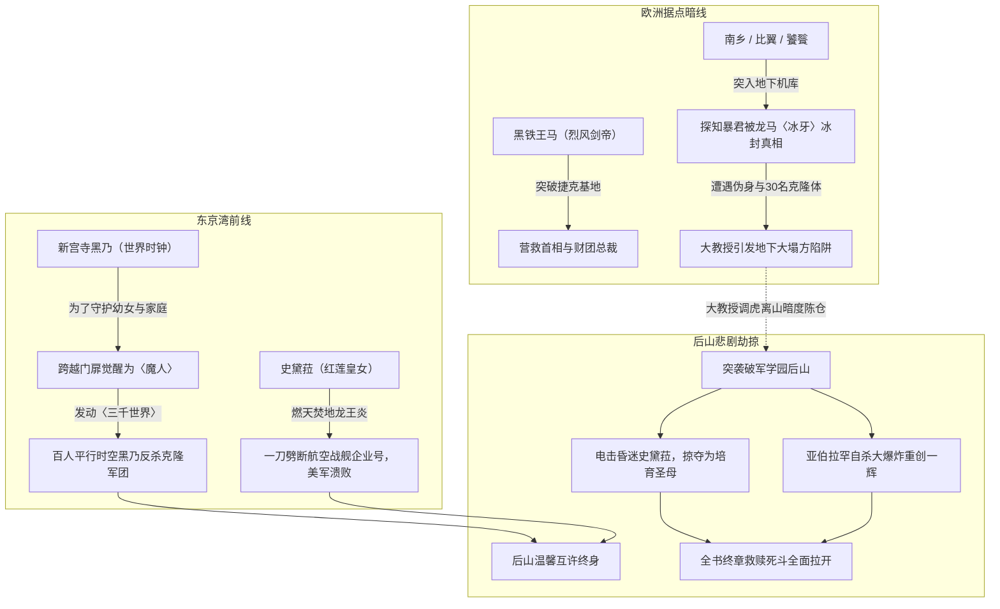

# 《落第骑士英雄谭》第十八卷：卷内时间线与关键事件锚点

## 1. 时间轴设计说明

本时间线针对《落第骑士英雄谭 第十八卷》（材料标识：`MAT-018`）进行高保真跨国多线时间锚定。第十八卷涵盖了**欧洲特种突袭**（捷克美军基地营救与王马御风返日）、**东京湾防卫战最终决算**（黑乃魔人觉醒、史黛菈一剑劈裂企业号）、**二十米地下机库伏击战**（南乡、比翼与饕餮直面暴君遗体与大教授陷阱），以及最终日夜晚破军后山的**悲剧突袭与史黛菈被劫**。与第十七卷东京海战/九州大捷（2013年9月14日）及第十至十五卷法米利昂战役日历严格咬合。

---

## 2. 卷内时间轴事件清单（T01–T08）

| 节点编号 | 公历绝对日期 / 正典相对时间 | 涉及章节与行号 | 发生地点 | 核心参与人物 | 核心事件与因果逻辑 |
|---|---|---|---|---|---|
| **T01** | 2013-09-12（周四）夜间至 09-13（周五）黎明 | 序章 `L3–L521` | 阿尔卑斯山〈解放军〉旧据点遗迹 | 亚伯拉罕·卡特、大教授卡尔·爱兰兹、风祭晄三、月影獏牙、风祭凛奈、莎拉、夏洛特、黑铁王马 | **暴君冰尸揭密与美军包围**。美军超能力部队PSYON截获晄三月影一行，押入深层王座揭示暴君早在五十年前已被龙马冰封，大教授掠走要人与暴君遗体以罗织开战借口；夏洛特借〈道旁之岩灰〉脱险，向循风而至的王马泣血求援。 |
| **T02** | 2013-09-13（周五）清晨至上午 | 第一章 `L522–L2145` | 捷克斯洛伐克·美军秘密特务基地 | 黑铁王马、亚伯拉罕·卡特、大教授卡尔·爱兰兹、月影獏牙、风祭晄三、风祭凛奈、莎拉、夏洛特 | **单骑破壁与〈断月天龙爪·真打〉**。爱兰兹变异月影耳朵并以二女受辱录像逼降；王马单刀破壁杀入，克服四年前心魔，为守护弱小解放天地暴风轰出至高奥义〈断月天龙爪·真打〉重创宿敌亚伯拉罕！ |
| **T03** | 2013-09-13（周五）上午至 09-14（周六）正午 | 第一章 `L2146–L2352` | 捷克基地至欧亚大陆高空、中国境内、对马基地 | 南乡寅次郎、黑铁王马、月影獏牙、风祭晄三、凛奈、莎拉、夏洛特 | **斗神言灵殿后与御风横越大陆**。南乡以言灵「放了他」定身三十名克隆体殿后；王马御风携五人狂飙返日，月影因恶梦高烧，在中国寻医后连夜疾驰，于9月14日正午平安抵日（与第17卷尾声急电精准咬合）。 |
| **T04** | 2013-09-14（周六）傍晚至入夜 | 第二章 `L2353–L2668` | 东京湾近海阵线、都心地下都市避难所 | 自卫队、破军学生骑士（兔丸恋恋、碎城雷等）、新宫寺黑乃、新宫寺拓海、新宫寺鸣 | **首日战后休整与慈母的私心**。全军苦守击退美军第一天攻势，美军暂退外海等待第二舰队明早会合；黑乃赴地下避难所探视丈夫拓海与三岁女儿小鸣，深感自己因家庭幸福逃避觉醒魔人之软弱。 |
| **T05** | 2013-09-15（周日）清晨至上午 | 第二章 `L2669–L3842` | 东京湾防线外海至都心避难所外壁 | 新宫寺黑乃、阿普顿提督、绫辻绚濑、自卫队、数十名亚伯拉罕克隆人、新宫寺拓海、新宫寺鸣 | **亚伯拉罕军团登陆与魔人觉醒·〈三千世界〉**。两支美军舰队总攻，克隆军团撕裂防线，企业号88寸主炮轰穿地下避难所外壁危及黑乃家眷；黑乃大彻大悟跨越门扉觉醒为〈魔人〉，施展时空神技〈三千世界〉百身重叠反杀全灭克隆军团！ |
| **T06** | 2013-09-15（周日）上午至正午 | 第二章 `L3843–L4785` | 东京湾海空万米高空至东京湾外海 | 史黛菈·法米利昂、黑铁一辉（正太态）、黑铁珠雫、西京宁音、道格拉斯·阿普顿提督、黑铁严 | **龙王炎断天与卫国完全胜利**。法米利昂援军神速杀回，史黛菈张开实体龙翼施展〈燃天焚地龙王炎〉一刀将500米倒悬航母企业号力劈两半！美军败退关岛，黑铁严宣布日本赢得卫国战争！ |
| **T07** | 2013-09-15（周日）傍晚至入夜（王马逃离3天后） | 第三章 `L4786–L5867` | 欧洲捷克塔特拉山腰至美军地下20米机库 | 南乡寅次郎、爱德怀斯（比翼）、福小莉（饕餮）、大教授爱兰兹（伪身）、30名克隆人、风祭晄三、月影 | **暴君冰封真相与地下塌方陷阱**。晄三得知海战大胜但月影恶梦惊醒预言灾难未至；欧洲南乡苦战3日后与比翼、饕餮汇合，突入机库探明龙马以〈冰牙〉冻结暴君真相，反遭大教授三十个克隆体塌方活埋（调虎离山）。 |
| **T08** | 2013-09-15（周日）夜晚 22:00 至深夜 | 第三章 `L5868–L6470` | 破军学园后山环湖林道、露天浴室、观湖高崖 | 黑铁一辉（正太体型）、史黛菈·法米利昂、大教授卡尔·爱兰兹（真身）、亚伯拉罕克隆体、黑铁珠雫 | **后山永恒誓言、圣母被劫与自爆火海惨剧**。一辉与史黛菈洗发温存许下多生小孩终身誓约；大教授潜入日本突袭，电击颈椎掳走史黛菈作为“圣母”孕育终极生命，无头亚伯拉罕自爆重创一辉濒死坠入火海，珠雫绝望尖叫，全书进入终极复仇战！ |

---

## 3. 战略碰撞与命运陷阱结构图

