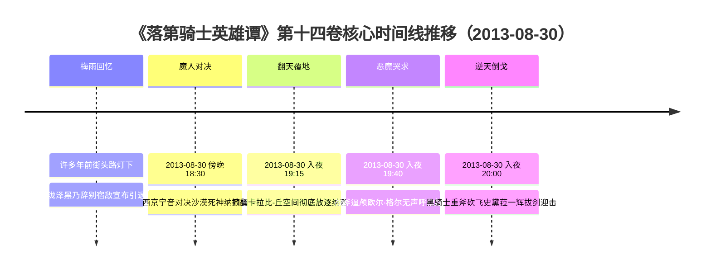

# 第十四卷卷内时间线：全量锚定与时序坐标

> **权威材料依据**：`落第骑士英雄谭 第十四卷 gbk.txt`（`MAT-014`，6,612 行全量原著正文）  
> **日历基准与时间规范**：严格接续第八卷（8/10 准决赛隔天）、第九卷（8/11 决赛、8/12 闭幕式）、第十卷（8/19 一周后专机启程、8/20 抵法米利昂及当夜惨案）、第十一卷（8/21 竞技场考核、8/22 卡尔迪亚防暴战与王宫血案）、第十二卷（8/23 达成协议登爱德贝格、8/24~28 五天暴风雪防守、8/29 下山锁死名单定于“明天日落开战”）。  
> **核心日期与绝对西历**：**西历 2013 年 8 月 30 日（星期五）傍晚至入夜**！  
> **事实状态标定**：`extracted`（原文显式字句确认）、`proposed`（卷内情节连续逻辑推导）。

---

## 一、宏观决战时序与对战结果

| 战局阶段 | 战场区域 | 对阵双方 / 核心视角 | 战术机理与演变 | 决战结果与赛势 |
|---|---|---|---|---|
| **回忆前瞻** | 日本街头孤寂路灯下 | **泷泽黑乃（新宫寺黑乃）与西京宁音** | 叩击十倍魔人石门 VS 守护身为人性的幸福 | **黑乃放弃魔人从 KOK 引退**，宁音心痛分道扬镳 |
| **主战力死斗** | 路榭尔荒漠化大广场 | **〈夜叉姬〉西京宁音 VS 〈沙漠死神〉纳西姆·萨利姆** | 概念干涉〈化骸尘暴〉 VS 纯粹重力〈黑刀·八咫乌〉与〈超度觉醒〉 | **双方陷入入魔死斗**，宁音重力压制暴打撕碎纳西姆 |
| **终极决杀** | 路榭尔南区深坑战圈 | **西京宁音 VS 纳西姆·萨利姆** | 纳西姆〈终末爆击〉 VS 宁音主动解除觉醒施展**〈翻天覆地〉** | **宁音胜**（以微观重力掀翻卡拉比·丘空间，纳西姆被放逐出四维时空消散） |
| **终盘惊天逆转** | 路榭尔王城中庭残破石柱 | **史黛菈 & 艾莉丝 VS 〈傀儡王〉欧尔·格尔** | 炎剑劈街合围绝杀 VS 恶魔无声假哭『姐姐救我』 | **艾莉丝倒戈横斧劈飞史黛菈**（魔人原初誓言暴走，一辉挺刀对决） |

---

## 二、卷内核心时间节点全量锚定（Anchor `T01` ～ `T05`）

---

### `T01` 许多年前梅雨夜·回忆羁绊：泷泽黑乃的引退心路
- **时间状态**：`extracted`
- **对应章节**：间章《泪雨》（L3–L177）
- **核心事件**：西京宁音冒雨等候泷泽黑乃（新宫寺黑乃），揪住衣领质问其为何在即将与自己争锋的前夕从 KOK·A 级联盟引退。黑乃坦承自己潜心闭关时曾叩开十倍高的“魔人石门”，但在迈进门内的瞬间，听到了恋人琢海送午餐的呼唤；黑乃慈爱轻抚小腹，决意不抛弃身为人性的因果与成为琢海妻子的未来，放弃跨足非人领域。黑乃深深向宁音鞠躬道歉，两名至高宿敌自此分道扬镳。
- **地点**：日本东京街头路灯下。

---

### `T02` 2013-08-30 傍晚 18:30–19:15·魔人对决：荒漠天灾与夜叉化身
- **时间状态**：`extracted`
- **对应章节**：第十九章《魔人对决》（L178–L2678）
- **核心事件**：奎多兰与法米利昂五年一度的五对五代表战接近尾声。B·B已被一辉击破，约翰已被史黛菈击坠并由露娜艾丝救回，幽衣与艾茵死斗两败俱伤；法米利昂已握有三胜。艾莉丝身着〈无敌甲胄〉于市区飞速追猎欧尔·格尔；而在荒漠化的中央战圈，西京宁音与世界最强佣兵纳西姆·萨利姆展开死斗。纳西姆发动〈化骸尘暴〉沙化城市，宁音以铁扇〈嫣红凤〉施展〈地缚阵〉与〈黑刀·八咫乌〉正面对轰；双方开启肉体灵装合一的〈超度觉醒〉，宁音身化嗜虐夜叉，在绝对暴力中踢碎纳西姆四肢、拔除钢尾，将其狠狠踩在脚下，却在嗜血狂欢中叩问自我的执念。
- **地点**：奎多兰王国首都·路榭尔荒漠化中央大广场。

---

### `T03` 2013-08-30 入夜 19:15–19:45·难舍情谊：卡拉比·丘空间掀翻与终极放逐
- **时间状态**：`extracted`
- **对应章节**：第二十章《难舍的情谊》（L2679–L5007）
- **核心事件**：宁音回忆起童年因汉堡排被继父踩碎而觉醒重力弑父、成为恶童夜叉姬，后被南乡寅次郎保释进武曲学园与黑乃相识的过往。现实中，纳西姆施展绝技〈终末爆击〉，变质肉体坚不可摧；宁音在极限关头洞察肉体自毁危险，**果断主动解除〈超度觉醒〉**，以扇尖刺中纳西姆胸膛微观点，施展出震撼物理法则的全新绝技——**〈翻天覆地〉**！以微观重力掀翻十的负三十一次方公分的卡拉比·丘空间，引动宇宙自身重力自愈修正，将被击中的纳西姆整个人彻底卷入微观卷缩空间、放逐于四维时空之外！沙漠死神湮灭消亡（宇宙体积缩小一人份），宁音力竭昏迷，赛局改写为 4:1。
- **地点**：路榭尔南区残破荒漠深坑。

---

### `T04` 2013-08-30 入夜 19:40–20:00·合围欧尔·格尔与假哭求救
- **时间状态**：`extracted`
- **对应章节**：第二十一章前半（L5008–L5650）
- **核心事件**：战场仅存孤身一人的欧尔·格尔。艾莉丝身披〈无敌甲胄〉紧咬围堵；史黛菈展开红莲双翼破空杀到，以百米龙炎巨剑〈燃天焚地龙王炎〉一剑劈开路榭尔街道封死退路，两人将欧尔·格尔死死压制在残破石柱上，艾莉丝的巨型战斧距离其颅骨仅差毫厘！在死亡彻底笼罩的最后一刻，欧尔·格尔收起所有嗜虐，挤出幼童般的恐惧眼泪，以双色异瞳死死盯住姐姐，以无声口型哭求：**『姐、姐……救救、我……』**！
- **地点**：路榭尔王城中庭残破石柱废墟。

---

### `T05` 2013-08-30 入夜 20:00–20:15·逆天倒戈、铠甲泣血与一辉迎击
- **时间状态**：`extracted`
- **对应章节**：第二十一章后半（L5651–L6570）
- **核心事件**：养母雷薇施加的虚假道德封印瞬间崩解，艾莉丝当年觉醒魔人的底层本能——【誓死保护弟弟欧尔雷斯】全面暴走反噬！艾莉丝面部扭曲发狂，**手中重斧变线，以排山倒海之势一斧劈飞同伴史黛菈**！史黛菈砸穿三道石墙呕血重创；艾莉丝裹在铠甲中浑身剧颤、发疯抓挠铠甲、头盔缝隙溢出泣血恸哭（“对不起……对不起……”），决绝背对欧尔·格尔嘶吼让他快逃，挡在弟弟身前阻击全世界！黑铁一辉拔出〈阴铁〉以对等之礼直视迎击，两位骑士在废墟前互报家门，拉开绝命殊死战序幕！
- **地点**：王城中央残破十字路口。
